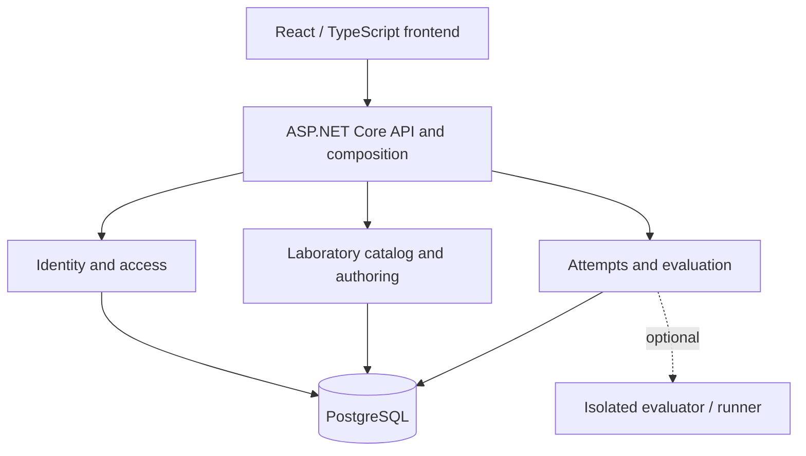

# Conceptual architecture

The platform is designed as a modular monolith. Internal modules communicate through explicit contracts and do not read or modify each other's internal state. This diagram is a starting point for component-level designs.

## Boundaries

- **Identity and access:** user identity, memberships, and resource authorization.
- **Catalog and authoring:** laboratories, revisions, publication, and assignments.
- **Attempts and evaluation:** attempt state, outcome checking, and feedback.
- **Data:** each module owns its invariants and data; access other modules through their contracts.
- **Execution:** an advanced capability in a separate trust boundary, outside the initial core.

Reference contracts include `IIdentityContext`, `IAccessDecision`, `ILabDefinitionReader`, `IAttemptStore`, `ILabEvaluator`, `IAuditWriter`, and optionally `IExecutionGateway`.

The identity login flow (`AuthController` and `LoginService`) checks credentials
through `ICredentialVerifier`, which also returns the account's current
`AccountStatus`, and creates a session through `ISessionCreator` only for `ACTIVE`
accounts. Blocked and archived accounts get the same rejection as wrong
credentials; only the audit event records the reason. Credential verification and
session creation belong to IDN-02; the account status rules belong to IDN-03.

Each project component requires its own architecture diagram using the [component template](templates/PROJECT_COMPONENT.md).

## Frontend authentication boundary (US-08)

The React frontend does not persist session tokens. The API owns the session in a
`HttpOnly`, `Secure`, `SameSite=Strict` cookie and exposes `/api/auth/me` as the
source of truth after an application load.

- `AuthProvider` owns the current user, loading state, login, and logout actions.
- `apiFetch` is the single client boundary for authenticated requests and clears
  the local user state when the API returns `401 Unauthorized`.
- `ProtectedApp` is rendered only after the initial `/api/auth/me` check succeeds.
- The server remains the security boundary: hiding the frontend is not an
  authorization check, and every protected API request is validated by the
  session middleware.
- React Router separates public pages (`/` and `/login`) from the protected
  laboratory route (`/access-demo`). `ProtectedRoute` controls navigation and
  rendering only; it does not replace server-side authorization.
