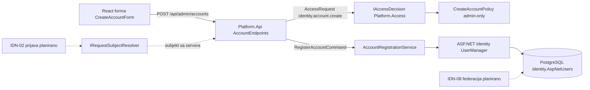
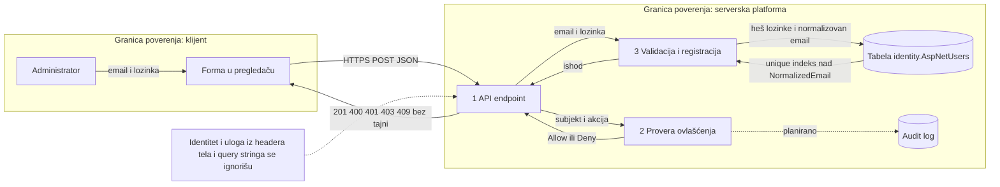

# IDN-01 — Kreiranje naloga (administratorsko)

| Stavka | Vrednost |
|---|---|
| Tim | Tim 18 |
| Zahtev | IDN-01 — Registracija naloga ili administratorsko kreiranje |
| Kriterijum prihvatanja | Kreira se jedinstven nalog. Postojeći identifikator se ne može ponovo dodeliti. |
| Status | Početna implementacija (servis, baza, testovi, admin endpoint, forma) |
| Projekti | `backend/Platform.Identity`, `backend/Platform.Identity.Tests`, `backend/Platform.Api`, `frontend` |
| Studenti | PR13/2023 Antonija Mitić, PR71/2023 Nina Budjen, PR65/2023 Milica Dukić, PR66/2023 Anđela Javor, PR72/2023 Jovana Boljanović |

## Odluke tima

- **Ko kreira naloge:** samo administrator. Javne samoregistracije nema.
- **Identifikator naloga:** email adresa, normalizovana (uklonjen razmak, mala slova).
- **Biblioteka:** ASP.NET Core Identity + EF Core + PostgreSQL. Ne pišemo sopstvenu kriptografiju.
- **Nalozi se ne brišu fizički.** Arhiviran ili blokiran nalog i dalje zauzima email i `Id`, pa se identifikator ne može ponovo dodeliti.

## Odgovornosti i podela rada

| Tapiz priča | Student | Sadržaj |
|---|---|---|
| Domen i ugovori | Antonija | `AppUser`, `AccountStatus`, `RegistrationOutcome`, `RegisterAccountCommand/Result`, `IAccountRegistration` |
| Baza i migracije | Nina | `AccountDbContext`, šema `identity`, unique indeks, migracija `InitialAccounts` |
| Kreiranje naloga | Milica | `AccountRegistrationService` (validacija, heširanje preko Identity-ja, odbijanje duplikata) |
| Testovi kreiranja naloga | Anđela | NUnit testovi nad pravim PostgreSQL-om (Testcontainers) |
| Forma i dokumentacija | Jovana | React forma `CreateAccountForm`, ovaj dokument, dijagrami |
| (zajedno) |  | admin endpoint, `CreateAccountPolicy`, `IRequestSubjectResolver` |

## Ugovor za druge module

```csharp
ValueTask<RegisterAccountResult> RegisterAsync(
    RegisterAccountCommand command,
    CancellationToken cancellationToken = default);
```

Ishodi (`RegistrationOutcome`): `Created`, `IdentifierTaken`, `InvalidInput`. Rezultat nikada ne sadrži lozinku ni heš. `RegisterAccountCommand.ToString()` je redigovan da lozinka ne procuri u log.

### HTTP ugovor

`POST /api/admin/accounts`, telo `{ "email": "...", "password": "..." }`.

| Status | Telo | Značenje |
|---|---|---|
| 201 | `{ id, correlationId }` | Nalog kreiran |
| 400 | `{ error: "invalid_input", errors[], correlationId }` | Nevalidan email ili lozinka |
| 401 | `{ error: "unauthenticated", correlationId }` | Pozivalac nije poznat |
| 403 | `{ error: "forbidden", correlationId }` | Pozivalac nije administrator |
| 409 | `{ error: "identifier_taken", correlationId }` | Email već postoji |

Identitet pozivaoca dolazi sa servera (`IRequestSubjectResolver`), nikada iz headera, tela ili query stringa.

## Arhitektura komponente



**Veza sa platformom:** `Platform.Identity` registruje svoju akciju i politiku u `Platform.Access` preko javnih `InMemory*` registara. Ostali moduli dobijaju identitet naloga kroz ugovore, ne čitaju tabelu direktno.

## Dijagram toka podataka (DFD)



**Procesi:**

1. **API endpoint:** prima zahtev, traži odluku od Access modula, tek tada poziva servis.
2. **Provera ovlašćenja:** `DefaultDenyAccessDecision`. Samo politika `identity.account.create.admin-only` može vratiti `Allow`. Sve ostalo je `Deny`.
3. **Validacija i registracija:** normalizacija emaila, provera formata i dužina, pravila lozinke (min. 12 karaktera, veliko i malo slovo, broj, specijalan znak), heširanje, upis.

**Negativni tokovi:** nepoznat pozivalac → 401. Nije administrator → 403. Nevalidan unos → 400, ništa se ne upisuje. Duplikat → 409, i kad je razlika samo u velikim slovima ili razmaku, i kad dva zahteva stignu istovremeno.

**Osetljivi podaci:** lozinka putuje samo u telu zahteva, heširanje radi Identity (ne sopstveni kod), u bazi je samo heš. Lozinka se ne upisuje u log (`ToString` je redigovan) i ne vraća se u odgovoru. Forma briše lozinku iz stanja čim server odgovori.

**Implementirano vs planirano**

| Implementirano | Planirano |
|---|---|
| Servis, validacija, heširanje, unique indeks, migracija | Prava prijava (IDN-02), zamena `IRequestSubjectResolver` |
| Admin endpoint + Access politika | Persistentan audit (`NullAccessAuditWriter` je privremen, AUD-01) |
| Probni admin u `Development` režimu, 401 u ostalim | Mapiranje statusa naloga na `AccountState` (`IIdentityContext`) |
| React forma | Ograničenje broja zahteva na endpointu (SEC-04) |
| Testovi servisa nad pravim PostgreSQL-om | HTTP testovi za 401/403/409/400, CI job za testove |
| | Federacija preko OIDC (IDN-08, odvojena grana) |

## Bezbednosni zahtevi

- **Server-side provera pristupa:** endpoint ne radi ništa pre odluke `IAccessDecision`. Nepoznata akcija ili politika daje `Deny`. Forma nije bezbednosna granica.
- **Validacija unosa:** email ≤ 254 karaktera i važeći format, lozinka ≤ 128 karaktera (zaštita od preskupog heširanja). Poruke servera se u formi prikazuju kao običan tekst (React ih escape-uje).
- **Poruke o greškama:** 401, 403 i 409 ne otkrivaju unutrašnja pravila osim samog ishoda. Svaki odgovor nosi `correlationId`.
- **Tajne:** connection string je u user-secrets, ne u Git-u. U `appsettings` nema lozinki.

## Mapiranje na kriterijum prihvatanja

| Zahtev | Kako je ispunjeno | Dokaz (test) |
|---|---|---|
| Kreira se jedinstven nalog | `Guid` kao `Id`, unique indeks na `NormalizedEmail` | `Valid_registration_creates_active_account_with_hashed_password` |
| Duplikat se odbija | provera Identity-ja + hvatanje `UniqueViolation` | `Duplicate_email_is_rejected`, `Duplicate_email_differing_only_in_case_or_whitespace_is_rejected` |
| Trka dva zahteva | unique indeks u bazi | `Concurrent_registrations_of_same_email_create_exactly_one_account` |
| Identifikator se ne dodeljuje ponovo | nalozi se ne brišu, arhiviran zadržava email | `Identifier_of_archived_account_cannot_be_reused` |
| Nevalidan unos | validacija emaila i lozinke | `Invalid_email_is_rejected`, `Weak_password_is_rejected_and_no_account_is_created` |
| Lozinka ne curi | redigovan `ToString`, samo heš u bazi | `Command_ToString_does_not_leak_password` |


## Spoljne zavisnosti i sledeći koraci

- **IDN-02 (prijava):** tim isporučuje stvarni identitet pozivaoca. Menja se samo implementacija `IRequestSubjectResolver`, endpoint ostaje isti. [DOPUNITI: sa kim je dogovoreno]
- **(Access):** dogovoriti stabilan način registracije akcija i politika, i razlog odbijanja kada politika vrati `false` (trenutno `PolicyError`).
- **Audit:** zameniti `NullAccessAuditWriter` kad audit tim isporuči adapter.
- Sledeće: HTTP testovi, CI job za testove, ograničenje broja zahteva, `IIdentityContext`.
