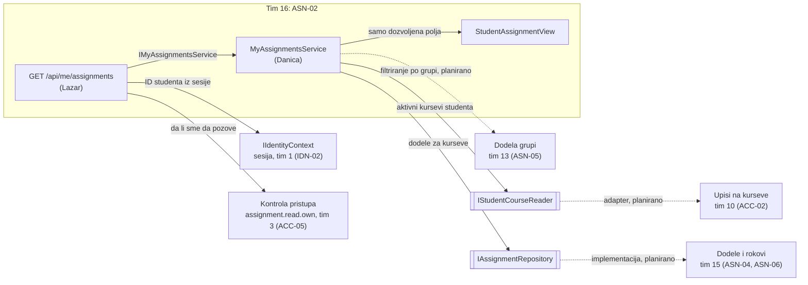
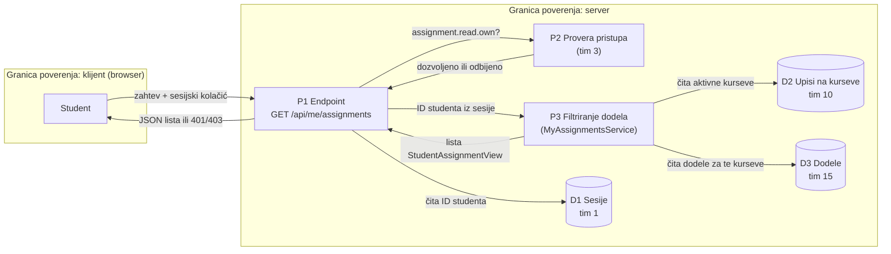

# Project component: ASN-02, filtriranje dodela studenta

**Team:** 16

**Student:** Danica Nikolić (PR 98/2022)

**Specification requirements:** ASN-02 (povezano: ASN-20, ASN-05, ASN-06, ASN-09)

## Responsibilities and boundaries

- Processes and user scenarios: student traži listu svojih zadataka. Servis vraća samo dodele sa kurseva na koje je student aktivno upisan, i samo polja koja student sme da vidi.
- Contracts with other modules:
  - `IMyAssignmentsService` (nudimo): koristi ga API endpoint `GET /api/me/assignments` (Lazar, tim 16).
  - `IStudentCourseReader` (tražimo): aktivni kursevi studenta, implementacija nad modulom za upise (tim 10, ACC-02).
  - `IAssignmentRepository` (koristimo): dodele kurseva, modul `Platform.Assignments` (tim 15).
- Implementation status: modul `Platform.AssignmentOverview`, model `StudentAssignmentView`, oba ugovora, `MyAssignmentsService` i 4 NUnit testa su implementirani (PR #114). In-memory podaci, pravila za arhivirane, istekle i duplikate i povezivanje sa pravim modulima su planirani.

## Component architecture

Pune strelice postoje u kodu. Isprekidane su planirane veze sa modulima drugih timova. Kutije sa duplim ivicama su ugovori (interfejsi) na granici modula.

## Data flow diagram

Sve što dolazi od klijenta je nepouzdano. Klijent ne šalje ID studenta: on se uzima iz sesije na serveru. Odluka o tome šta student vidi donosi se na serveru, ne u interfejsu.

## Decisions and dependencies

| Tema | Odluka |
|---|---|
| Tuđi moduli | Ne čitamo tuđe baze, već koristimo ugovore (`IStudentCourseReader`, `IAssignmentRepository`). |
| Polja u odgovoru | `StudentAssignmentView` ne sadrži interna pravila dodele (npr. `AllowStartAfterDeadline`). |
| Odbrana u dubinu | Dodela sa kursa koji nije studentov odbacuje se čak i ako je repozitorijum vrati. |
| ACC-17 (provera aktivnog upisa) | Ne radi nijedan tim. Aktivnost upisa (`Active` + `Student`) proverava adapter za `IStudentCourseReader`. |
| ASN-09 (otkazivanje) | Ne radi nijedan tim. Otkazana dodela = status `Archived`; prikazuju se samo `Active` dodele (sprint 2). |
| ASN-01, ASN-03, ASN-17 | Ne radi nijedan tim. Dodele dolaze iz test podataka; istek računa `Assignment.GetAvailability` (tim 15). |
| Istekle dodele | Ne prikazuju se, uz poštovanje individualnog produženja (ASN-06, tim 15) (sprint 2). |
| ASN-20 (bez duplikata) | Ne radi nijedan tim; pokriva ga naše pravilo protiv duplikata (sprint 2). |
| ASN-05 (grupe) | Radi tim 13; filtriranje po grupi kad model bude dostupan. |
| ID kursa | Kod tima 15 `string`, kod članstava `Guid`; usaglašavanje sa timovima 21 i 15. |

## Security requirements

- Server-side access checks: endpoint traži akciju `assignment.read.own` (tim 3, PR #109); servis vraća samo dodele kurseva na koje je student aktivno upisan.
- Input validation and sensitive data: prazan ID studenta se odbija (`ArgumentException`); odgovor sadrži samo polja iz `StudentAssignmentView`.
- Negative scenarios:

| Pretnja | Kontrola | Test |
|---|---|---|
| Student vidi dodelu tuđeg kursa | filtriranje po aktivnim kursevima | `Student_DoesNotSeeAssignmentFromOtherCourse` |
| Greška u tuđem modulu vrati tuđu dodelu | ponovna provera kursa u servisu | `ForeignAssignment_IsFilteredEvenIfRepositoryReturnsIt` |
| Zahtev bez identiteta studenta | odbijanje praznog ID-ja | `EmptyStudentId_IsRejected` |
| Student traži tuđu listu menjanjem ID-ja (IDOR) | ID se uzima samo iz sesije (endpoint) | planirano, Lazar i Luka |

## Evidence of work

- Pull request: #114 (8 commitova u `feature/ASN-02-ASN-07`).
- Run instructions: `dotnet test backend/Platform.AssignmentOverview.Tests`
- Tests and results: 4/4 prolaze lokalno i u CI-u (`Platform.AssignmentOverview.Tests.dll`).
- Next steps: pravila za arhivirane, istekle i duplikate (sprint 2); adapter nad modulom tima 10 i prava implementacija dodela tima 15 (sprint 3).