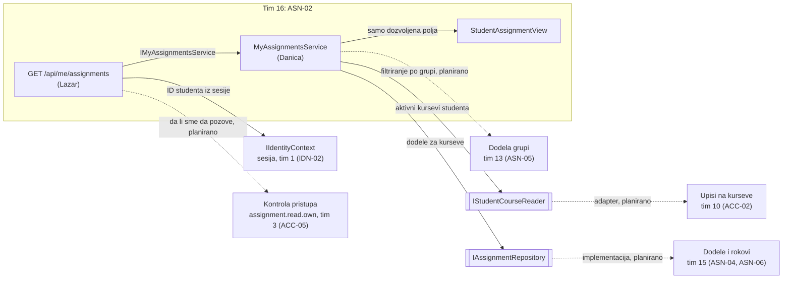
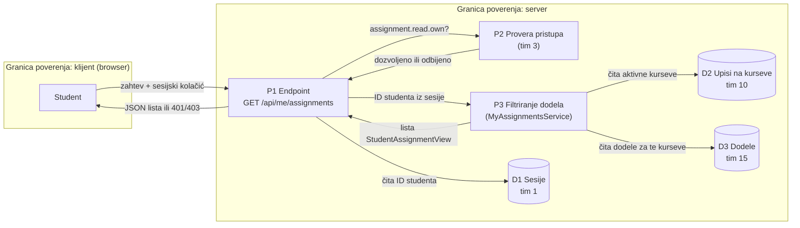

# Project component: ASN-02, filtriranje dodela studenta

**Team:** 16

**Student:** Danica Nikolić (PR 98/2022)

**Specification requirements:** ASN-02 (povezano: ASN-20, ASN-05, ASN-06, ASN-09)

## Responsibilities and boundaries

- Processes and user scenarios: student traži listu svojih zadataka. Servis vraća samo dodele sa kurseva na koje je student aktivno upisan, i samo polja koja student sme da vidi.
- Contracts with other modules:
  - `IMyAssignmentsService` (nudimo): koristi ga API endpoint `GET /api/me/assignments` (Lazar, tim 16).
  - `IStudentCourseReader` (tražimo): aktivni kursevi studenta, implementacija nad modulom za upise (tim 10, ACC-02).
  - `IAssignmentRepository` (koristimo): dodele kurseva, modul `Platform.Assignments` (tim 15).
- Implementation status: modul `Platform.AssignmentOverview`, model `StudentAssignmentView`, oba ugovora, `MyAssignmentsService` i 4 NUnit testa su implementirani (PR #114). Endpoint `GET /api/me/assignments` (PR #132) i privremeni in-memory podaci za Development su implementirani. Pravila za arhivirane, istekle i duplikate, provera pristupa preko `assignment.read.own` i povezivanje sa pravim modulima su planirani.

## Component architecture



Pune strelice postoje u kodu. Isprekidane su planirane veze sa modulima drugih timova. Kutije sa duplim ivicama su ugovori (interfejsi) na granici modula. Do povezivanja sa pravim modulima, ugovore u Development okruženju zamenjuju privremene in-memory klase `DevelopmentStudentCourseReader` i `DevelopmentAssignmentRepository`, a izvan Developmenta `Unavailable*` klase koje bacaju grešku.

## Data flow diagram



Sve što dolazi od klijenta je nepouzdano. Klijent ne šalje ID studenta: on se uzima iz sesije na serveru. Odluka o tome šta student vidi donosi se na serveru, ne u interfejsu.

Trenutno P2 nije u kodu: sesiju proverava `SessionCheckMiddleware` (bez važeće sesije 401), a endpoint koristi `DelegatesToLegacyAuthorization`. Akcija `assignment.read.own` ima opseg `Course` sa resursom `assignment`, a naša ruta nema ID kursa, pa se sa timom 3 dogovara kako da se koristi za listu.

## Endpoint

`GET /api/me/assignments`, bez parametara. Student dolazi iz sesije (kolačić `SecurityLab.Session`); parametri poput `?studentId=` se ignorišu.

| Situacija | Odgovor |
|---|---|
| Bez sesije, nepoznata ili opozvana sesija, sesija sa čekanjem na MFA | 401 (`{ "error": "unauthenticated", "correlationId": "..." }` iz endpointa, prazno telo iz middleware-a) |
| Važeća sesija | 200 |

```json
{
  "assignments": [
    {
      "assignmentId": "a0000000-0000-0000-0000-000000000001",
      "courseId": "course-oib",
      "publishedLabRevisionId": "rev-sql-injection-1",
      "availableFromUtc": null,
      "dueAtUtc": "2027-01-31T22:59:00+00:00",
      "maxAttempts": 3
    }
  ],
  "correlationId": "526bc5edf9f346f6bebb5994898349e8"
}
```

Datumi su UTC, `availableFromUtc` može biti `null`. Odgovor ima `Cache-Control: no-store`. Nema naziva kursa ni vežbe, samo ID-jevi.

Podaci za Development (privremeni): student `student@example.com` (`22222222-2222-2222-2222-222222222222`) je upisan na `course-oib` i `course-security`, a postoji i dodela na kursu `course-other` koju ne sme da vidi.

Ručna provera: u `.env` moraju da postoje `ConnectionStrings__Identity` i `Seed__DevelopmentPassword` (vidi `.env.example` i `docs/DEVELOPMENT.md`), zatim `docker compose up -d db`, `dotnet run --project backend/Platform.Api --urls http://localhost:5080`, prijava kao `student@example.com` na `POST /api/auth/login` i `GET /api/me/assignments` sa dobijenim kolačićem.

## Decisions and dependencies

| Tema | Odluka |
|---|---|
| Tuđi moduli | Ne čitamo tuđe baze, već koristimo ugovore (`IStudentCourseReader`, `IAssignmentRepository`). |
| Polja u odgovoru | `StudentAssignmentView` ne sadrži interna pravila dodele (npr. `AllowStartAfterDeadline`). |
| Odbrana u dubinu | Dodela sa kursa koji nije studentov odbacuje se čak i ako je repozitorijum vrati. |
| ACC-17 (provera aktivnog upisa) | Ne radi nijedan tim. Aktivnost upisa (`Active` + `Student`) proverava adapter za `IStudentCourseReader`. |
| ASN-09 (otkazivanje) | Ne radi nijedan tim. Otkazana dodela = status `Archived`; prikazuju se samo `Active` dodele (sprint 2). |
| ASN-01, ASN-03, ASN-17 | Ne radi nijedan tim. Dodele dolaze iz test podataka; istek računa `Assignment.GetAvailability` (tim 15). |
| Istekle dodele | Ne prikazuju se, uz poštovanje individualnog produženja (ASN-06, tim 15) (sprint 2). |
| ASN-20 (bez duplikata) | Ne radi nijedan tim; pokriva ga naše pravilo protiv duplikata (sprint 2). |
| ASN-05 (grupe) | Radi tim 13; filtriranje po grupi kad model bude dostupan. |
| ID kursa | Kod tima 15 `string`, kod članstava `Guid`; usaglašavanje sa timovima 21 i 15. |

## Security requirements

- Server-side access checks: endpoint traži važeću sesiju (`SessionCheckMiddleware`), a servis vraća samo dodele kurseva na koje je student aktivno upisan. Provera akcije `assignment.read.own` (tim 3) je planirana.
- Input validation and sensitive data: prazan ID studenta se odbija (`ArgumentException`); odgovor sadrži samo polja iz `StudentAssignmentView`.
- Negative scenarios:

| Pretnja | Kontrola | Test |
|---|---|---|
| Student vidi dodelu tuđeg kursa | filtriranje po aktivnim kursevima | `Student_DoesNotSeeAssignmentFromOtherCourse` |
| Greška u tuđem modulu vrati tuđu dodelu | ponovna provera kursa u servisu | `ForeignAssignment_IsFilteredEvenIfRepositoryReturnsIt` |
| Zahtev bez identiteta studenta | odbijanje praznog ID-ja | `EmptyStudentId_IsRejected` |
| Student traži tuđu listu menjanjem ID-ja (IDOR) | ID se uzima samo iz sesije (endpoint) | `ClientCannotChooseTheStudent_SessionAlwaysWins` |
| Neprijavljen korisnik | 401, servis se ne poziva | `NoSessionCookie_Returns401_AndServiceIsNotCalled` |
| Opozvana ili nepoznata sesija | 401, servis se ne poziva | `UnknownOrRevokedSession_Returns401_AndServiceIsNotCalled` |
| Sesija koja čeka MFA | 401, servis se ne poziva | `SessionWithPendingMfa_Returns401_AndServiceIsNotCalled` |
| Odgovor otkriva interna polja | poseban DTO odgovora | `ResponseContainsOnlyStudentVisibleFields` |
| Izvan Developmenta vraćeni izmišljeni podaci | `Unavailable*` klase bacaju grešku | `OutsideDevelopment_FailsClosed_InsteadOfReturningInventedData` |

## Evidence of work

- Pull request: #114 (8 commitova u `feature/ASN-02-ASN-07`).
- Run instructions: `dotnet test backend/Platform.AssignmentOverview.Tests` i `dotnet test backend/Platform.MyAssignments.Tests`
- Tests and results: `Platform.AssignmentOverview.Tests` 4/4 i `Platform.MyAssignments.Tests` 11/11 prolaze lokalno. Endpoint je ručno proveren na pokrenutom API-ju: bez prijave 401, kao `student@example.com` 200 sa dve dodele.
- Next steps: pravila za arhivirane, istekle i duplikate i log odbijenih zahteva (sprint 2); provera `assignment.read.own` kad tim 3 odgovori; adapter nad modulom tima 10, prava implementacija dodela tima 15 i prava sesija u Access modulu (sprint 3).