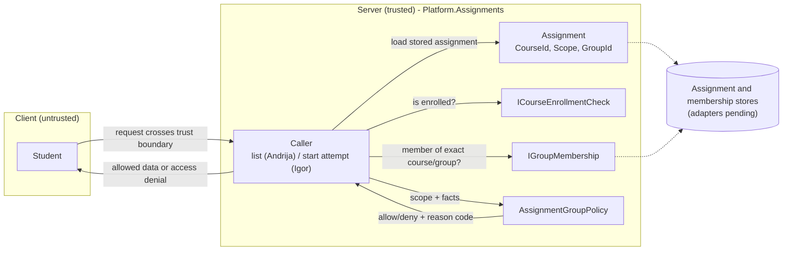

## Đorđe Marković – group membership and visibility policy

**Student:** Đorđe Marković / PR 69/2022

### Purpose

This part defines the rule that decides whether an enrolled student may see an assignment:

- A course-scoped assignment is visible to an enrolled student in that course.
- A group-scoped assignment is visible only to an enrolled student who belongs to the assignment's group in that course.
- A missing enrollment, missing group membership, or unsupported assignment scope is denied by default.

The policy receives facts collected by its caller. Those facts must come from server-side assignment, enrollment, and membership data, never from client claims.

### Responsibilities and boundaries

| Component | Responsibility | Owner | Status |
| --- | --- | --- | --- |
| `Assignment` / `AssignmentScope` | Stores whether an assignment applies to a course or a group, and its `GroupId`. | Igor | Implemented |
| `IGroupMembership` | Answers whether a student belongs to a specific group on a specific course. | Đorđe | Implemented |
| `InMemoryGroupMembership` | In-memory membership set for tests and development, keyed by the exact course, group, and student IDs. | Đorđe | Implemented; not persistent |
| `AssignmentGroupPolicy` | Pure allow/deny decision from scope, enrollment, and membership facts, with a stable reason code. | Đorđe | Implemented and unit-tested |
| Start-attempt check | Applies the policy before a student starts an attempt. | Igor | Implemented |
| Assignment list filtering (`VisibleAssignmentsService`) | Applies the policy before returning the assignment list. | Andrija | Implemented |
| Production membership adapter and DI registration | Supplies real membership data to `IGroupMembership`. | Membership/storage owners | Pending (KT2) |

This part does not persist groups or memberships. The in-memory implementation loses its data when the process stops.

### Decision rules

| Condition | Decision | Code |
| --- | --- | --- |
| Scope is neither `Course` nor `Group` | Deny | `UnsupportedScope` |
| Student is not enrolled in the course | Deny | `NotEnrolled` |
| Scope is `Course` and the student is enrolled | Allow | `CourseStudent` |
| Scope is `Group`, student is enrolled and is a member of that group | Allow | `GroupMember` |
| Scope is `Group`, student is enrolled but is not a member of that group | Deny | `NotGroupMember` |

Enrollment is required even when a group-membership record exists, so a stale membership record cannot grant access to a student who has left the course.

### Architecture and data flow

Everything the client sends is untrusted. The server loads the assignment's `CourseId`, `Scope`, and `GroupId` from storage and checks enrollment and membership itself; only the decision leaves the server.



### Security considerations

- The caller loads `CourseId`, `Scope`, and `GroupId` from the stored assignment; it never trusts a client-supplied group ID or membership claim.
- Group membership is checked for the exact `(courseId, groupId, studentId)` tuple.
- Enrollment and membership failures deny access. Unsupported scope values also deny access.
- The reason code is for server-side diagnostics only. Client responses do not reveal whether a private assignment exists or which group owns it.
- The same rule is used for listing and for starting an attempt, so a guessed assignment ID cannot bypass list filtering.

### Tests and verification

| Test class | Covers |
| --- | --- |
| `AssignmentGroupPolicyTests` | Course access, group-member access, non-member denial, non-enrolled denial, unsupported scopes |
| `InMemoryGroupMembershipTests` | Exact course/group/student matching, missing values, invalid input |

```powershell
dotnet test backend/Platform.Tests/Platform.Tests.csproj --filter "FullyQualifiedName~AssignmentGroupPolicyTests|FullyQualifiedName~InMemoryGroupMembershipTests"
```

All 19 focused test cases pass.

### Files

- `backend/Platform.Assignments/Contracts/IGroupMembership.cs`
- `backend/Platform.Assignments/Infrastructure/InMemoryGroupMembership.cs`
- `backend/Platform.Assignments/Application/AssignmentGroupPolicy.cs`
- `backend/Platform.Tests/Assignments/AssignmentGroupPolicyTests.cs`
- `backend/Platform.Tests/Assignments/InMemoryGroupMembershipTests.cs`
