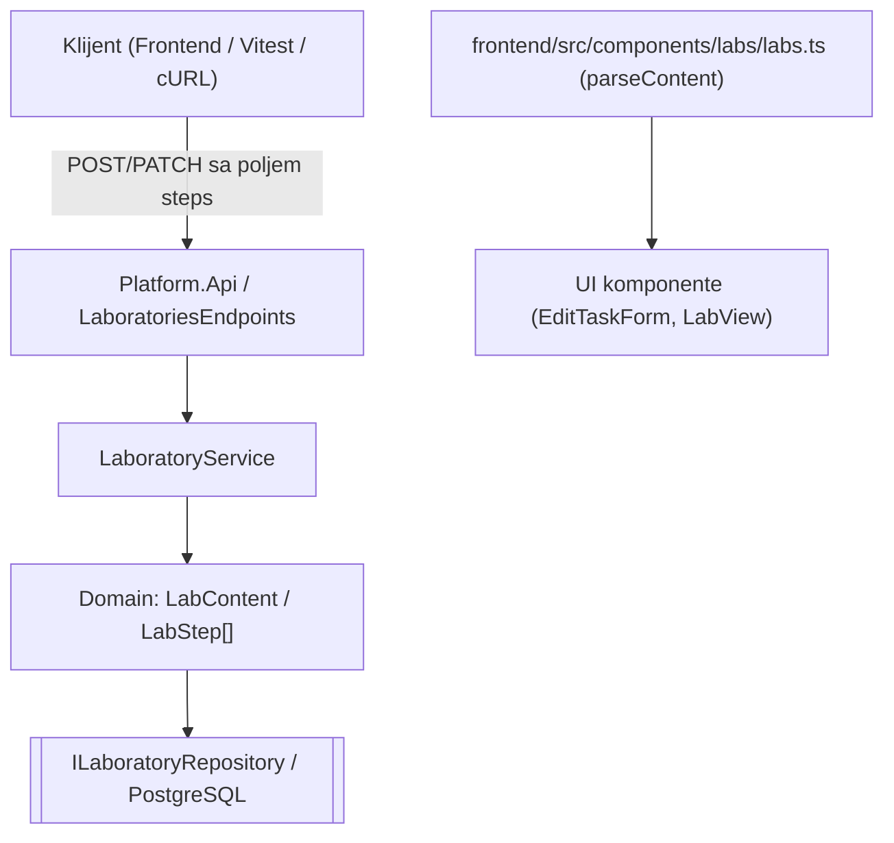
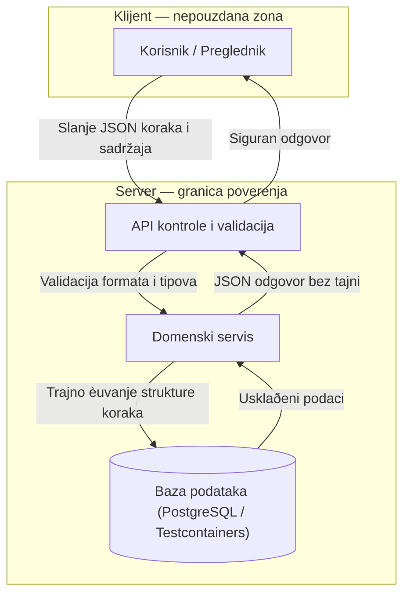

# AUT-02: Strukturisani koraci i uputstva laboratorije

**Tim:** 11

**Student:** Mihailo Rodic (student ID: PR 78/2023)

**Zahtevi:** AUT-02 (strukturisani koraci i uputstva);

**Grana:** `feature/AUT-02-lab-step`

## Odgovornosti i granice

Ovaj deo implementira strukturisane korake (`LabStep[]`) u domenskom modelu laboratorije, kao i prilagoðavanje API i frontend sloja za njihovo ispravno parsiranje i èuvanje.

- `LabContent` sada podržava niz strukturisanih koraka umesto èistog tekstualnog formata.
- Backend modeli i DTO objekti su prošireni da primaju i šalju polje `steps`.
- Frontend funkcija `parseContent` u `labs.ts` je usklaðena za rad sa novim `steps` poljem.

HTTP kontroleri, autorizacione politike, baza i verifikacija ostalih modula prate standardnu arhitekture tima.

## Arhitektura komponente



Domenski model validira prisustvo i strukturu koraka pre slanja u skladište podataka.

## DFD i granica poverenja



Svi ulazni podaci sa klijenta prolaze serversku validaciju pre upisa u domenski model.

## Bezbednosna pravila i validacija

### Struktura koraka
- Koraci moraju biti validno mapirani u niz `LabStep[]`.
- Nazivi i opisi koraka podležu standardnoj sanitizaciji ulaza (XSS zaštita na frontendu i bekendu).
- Neispravne strukture ili nedostajuæi obavezni parametri vraæaju kontrolisanu `400 Bad Request` grešku.

### Integritet i prikaz
- Pregled laboratorija ispravno renderuje korake bez izvršavanja potencijalnih skripti.
- Server garantuje nepromenljivost metapodataka kreiranja tokom izmena koraka.

## Negativni scenariji i testovi

Testovi pokrivaju:
- odbijanje malicioznih skripti unutar koraka (XSS validacija);
- odbijanje nekompletnih ili loše struktuiranih koraka (`400 Bad Request`);
- verifikaciju ispravnosti rada sa bazom preko Testcontainers-a;
- stabilnost frontend parsera pri neoèekivanim formatima sadržaja.

## Dokazi rada

Izmenjeni i dodati fajlovi:
- `backend/Platform.Authoring/Domain/AuthoringErrors.cs`
- `backend/Platform.Authoring/Domain/LabContent.cs`
- `backend/Platform.Authoring/Domain/LabStep.cs`
- `backend/Platform.Authoring.Tests/Domain/LabContentStepTests.cs`
- `frontend/src/api/labs.ts`

Pokretanje testova:

- Backend (uz pokrenut Docker Desktop):
```powershell
dotnet test
```

- Frontend:
```powershell
npm test
```

Lokalna provera (Novembar 2026):
- Backend testovi: **1059 uspešnih, 0 neuspešnih**.
- Frontend testovi: **60 uspešnih kroz 8 test fajlova**.
- Build rešenja je potpuno stabilan i bez grešaka.

## Plan za KT2

- Dalja optimizacija integracionih testova sa bazom podataka.
- Proširivanje pokrivenosti edge-case scenarija za komplikovanije strukture koraka.