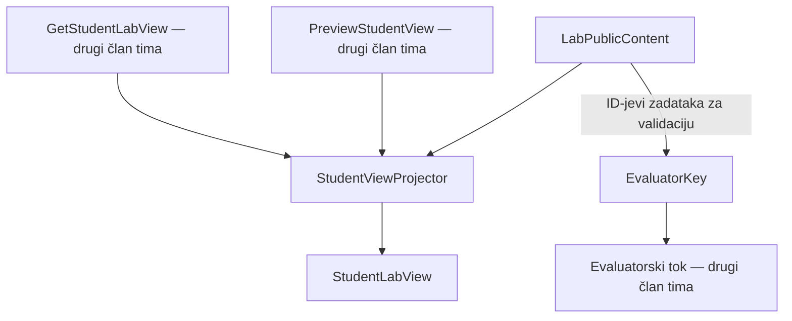
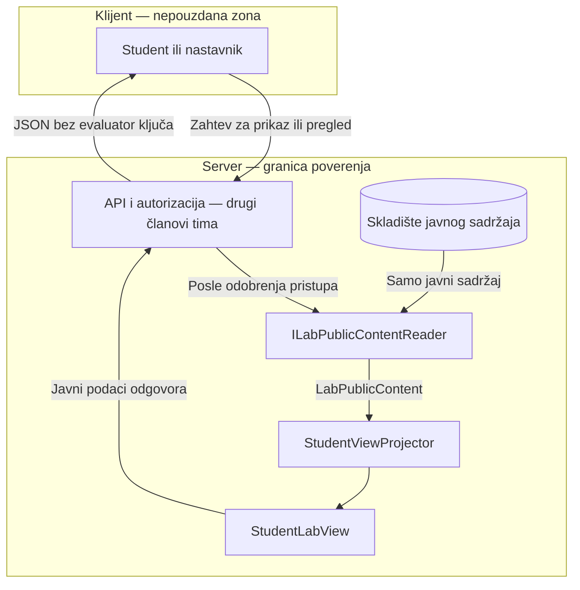

# AUT-04: Odvojen javni sadržaj i evaluator ključ

**Tim:** 6

**Student:** Vladimir Gajić

**Zahtevi:** AUT-04; zajednički projektor podržava AUT-07

**Grana:** feature/AUT-04-domain-split

**Reviewer:** Stojanović

## Odgovornosti i granice

Ovaj deo implementira domenske modele sa validacijom i projektor studentskog prikaza.

- LabPublicContent sadrži javne podatke laboratorije i zadataka.
- EvaluatorKey odvojeno sadrži tačne odgovore.
- StudentViewProjector prima isključivo LabPublicContent i vraća StudentLabView.
- Studentski prikaz i nastavnikov pregled koriste isti projektor.
- Postojeći ugovori ILabPublicContentReader i IEvaluatorKeyStore ostaju nepromenjeni.

Implementirani su domenski modeli, projektor i 17 test slučajeva.

HTTP kontroleri, autorizacione politike, baza, audit i frontend pripadaju drugim članovima tima. Njihova integracija nije dokazana ovim domenskim testovima.

## Arhitektura komponente



EvaluatorKey.Create koristi javni sadržaj da proveri pokrivenost zadataka.

Projektor nema parametar niti zavisnost tipa EvaluatorKey.

## DFD i granica poverenja



Dijagram prikazuje predviđeni integracioni tok.

Ovaj PR implementira modele i projekciju, a ne API i autorizaciju.

Evaluator ključ nije deo prikazanog toka i ne prelazi granicu server–klijent.

## Bezbednosna pravila i validacija

### Javni sadržaj

- ID laboratorije, kursa i autora ne sme biti Guid.Empty.
- Stanje laboratorije mora biti definisana vrednost enumeracije.
- Naslov i cilj ne smeju biti prazni.
- Zadaci ne smeju biti null i moraju imati jedinstven TaskId.
- TaskId se normalizuje uklanjanjem okolnih razmaka.
- Poređenje TaskId koristi StringComparer.Ordinal.
- Redosled je deterministički: Order, zatim TaskId.
- Tekst zadatka je obavezan, a Order ne sme biti negativan.
- Prazna lista opcija dozvoljava tekstualni zadatak.
- Prazna lista zadataka je dozvoljena; uslovi objavljivanja nisu deo ovog PR-a.

### Evaluator ključ

- Svaki javni zadatak mora imati tačno jedan odgovor.
- Nepoznati TaskId, dupli odgovori i nepotpun ključ se odbijaju.
- LabId se preuzima iz javnog sadržaja.
- Tačan odgovor ne sme biti prazan.
- Sadržaj odgovora se čuva bez Trim transformacije.
- TaskAnswerKey.ToString() i EvaluatorKey.ToString() skrivaju odgovore oznakom [REDACTED].
- Poruke validacionih grešaka ne uključuju vrednost odgovora.

### Nepromenljivost i prikaz

Domenska svojstva imaju samo get pristup.

Ulazne kolekcije se kopiraju i izlažu kao kolekcije samo za čitanje.

Projektor eksplicitno bira javna polja i kopira liste zadataka i opcija.

ToString zaštita nije zaštita od proizvoljne JSON serijalizacije ili strukturiranog logovanja. EvaluatorKey i TaskAnswerKey ne smeju biti prosleđeni klijentu niti direktno logovani.

Autorizacija se izvršava na serveru u pozivajućim servisima i politikama. Projektor ne odlučuje o pravu pristupa; pozivalac mora prethodno proveriti korisnika, kurs i stanje laboratorije.

## Negativni scenariji i testovi

Fajl: backend/Platform.Tests/LabVisibility/LabVisibilityDomainTests.cs

Testovi pokrivaju:

- odbijanje praznog naslova i cilja;
- odbijanje duplog TaskId;
- deterministički redosled zadataka;
- očuvanje sadržaja nakon promene ulaznih listi;
- prihvatanje kompletnog ključa i redosled odgovora;
- odbijanje nepotpunog ključa;
- odbijanje nepoznatog TaskId;
- odbijanje duplog odgovora;
- očuvanje ključa nakon promene ulazne liste;
- skrivanje odgovora u ToString();
- kopiranje javnih podataka kroz projektor;
- refleksijsku proveru dozvoljenih svojstava i polja studentskih modela;
- proveru dozvoljenih polja stvarnog JSON prikaza;
- odbijanje null ulaza projektora.

Refleksijska i JSON provera obuhvataju StudentLabView i StudentTaskView.

## Dokazi rada

Izmenjeni i dodati fajlovi:

- backend/Platform.LabVisibility/Domain/LabPublicContent.cs
- backend/Platform.LabVisibility/Domain/EvaluatorKey.cs
- backend/Platform.LabVisibility/Application/StudentView/StudentViewProjector.cs
- backend/Platform.Tests/LabVisibility/LabVisibilityDomainTests.cs
- docs/components/AUT-04-AUT-07/domain-split.md

Pokretanje testova ove komponente:

```powershell
dotnet test backend/Platform.Tests/Platform.Tests.csproj --configuration Release --filter FullyQualifiedName~LabVisibilityDomainTests
```

Pokretanje svih backend testova:

```powershell
dotnet test backend/SecurityLab.slnx --configuration Release
```

Lokalna provera 4.11.2026:

- Testovi ove komponente: 17 uspešnih, 0 neuspešnih, 0 preskočenih.
- Ceo backend: 340 uspešnih, 0 neuspešnih, 0 preskočenih.
- Build je uspešan.
- GitHub CI se proverava nakon push-a i otvaranja PR-a.

## Plan za KT2

Uskladiću korišćenje validiranih modela sa EF repozitorijumima i servisima kolega.

Proširiću testove graničnih ulaza i integracione provere jednakosti studentskog prikaza i pregleda pre objave.

Proveriću da povezivanje sa nacrtima i revizijama čuva odvajanje javnog sadržaja i evaluator ključa.