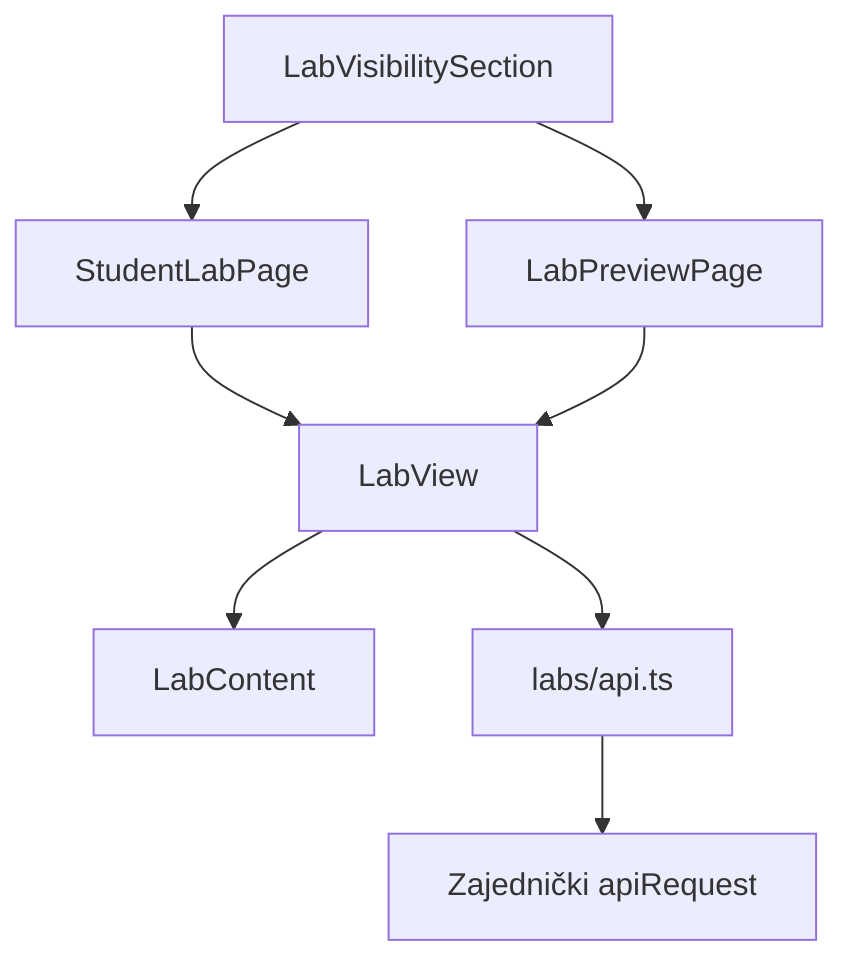
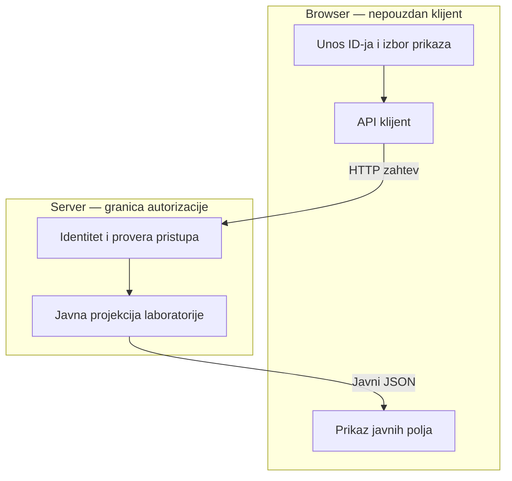

# AUT-07 — Studentski prikaz i pregled laboratorije

## Autor i obuhvat

Autor: Danilo Ferjuc
Grana: `feature/AUT-07-frontend`
Reviewer: Cvetojević

Implementacija obuhvata React ekrane, API klijent, razvojni izbor
korisnika, lokalni mock i frontend testove.

## Komponente i arhitektura

`LabVisibilitySection` omogućava unos ID-ja laboratorije i izbor prikaza.
U development režimu omogućava i izbor demo korisnika.

`StudentLabPage` učitava studentski prikaz.
`LabPreviewPage` učitava pregled pre objave i prikazuje traku
„Pregled kao student“.

Oba ekrana koriste `LabView` za učitavanje i obradu rezultata,
a `LabContent` za prikaz javnog sadržaja.

## API ugovori

| Namena | Metod i ruta | Očekivani odgovor |
| --- | --- | --- |
| Studentski prikaz | `GET /api/labs/{id}/student-view` | `StudentLabView` |
| Pregled pre objave | `GET /api/labs/{id}/preview` | `{ isPreview, state, view }` |

Frontend iz preview odgovora koristi `view`.
Javni tipovi obuhvataju naslov, cilj, zadatke, tekst pitanja i opcije.

Zajednički `apiRequest` upravlja zahtevima, sesijom i greškama.
Odgovori sa statusima 401, 403 i 404 u ovom modulu prikazuju istu
poruku „Laboratorija nije dostupna“.

## Tok podataka i granica poverenja

Server proverava identitet, članstvo na kursu, stanje laboratorije
i dozvolu za traženu radnju.

Frontend prikazuje konkretna javna polja. TypeScript tipovi sami
ne uklanjaju dodatna polja iz primljenog JSON-a.

`X-Stub-User` se dodaje samo kada je `import.meta.env.DEV`.
Razvojni birač korisnika takođe je dostupan samo u developmentu.

## Lokalni mock

Pokretanje iz foldera `frontend` koristi komandu `npm run dev:mock`.

Mock handler za ovaj modul nalazi se u `frontend/src/labs/mock.ts`.
Postojeći zajednički mock prosleđuje mu studentsku i preview rutu.

| Scenario | Demo ID |
| --- | --- |
| Objavljena laboratorija | `44444444-4444-4444-4444-444444444444` |
| Nacrt laboratorije | `55555555-5555-5555-5555-555555555555` |
| Nepostojeća laboratorija | `99999999-9999-9999-9999-999999999999` |

Mock simulira odgovore i pravila pristupa radi razvoja frontenda.
Provera sa stvarnim backendom ostaje zaseban integracioni korak.

## Provere i negativni testovi

`LabPages.test.tsx` za oba ekrana proverava prikaz javnog sadržaja
i izostavljanje dodatnog polja `expectedAnswer` i njegove vrednosti.
Takođe proverava isti renderovani rezultat za statuse 401, 403 i 404.

`api.test.ts` proverava slanje razvojnog identiteta u developmentu
i izostavljanje zaglavlja `X-Stub-User` u produkciji.

Nakon usklađivanja sa main granom, lokalno je prošlo svih 68 frontend testova komandom `npm test`.
TypeScript provera i produkcijski build uspešno prolaze komandom `npm run build`.

Ručno su u mock režimu provereni studentski prikaz objavljene
laboratorije, nastavnički pregled nacrta, odbijen pristup studenta
preview prikazu i prikaz nepostojeće laboratorije.

## Zavisnosti i integracija

Studentsku backend rutu implementira Stojanović.
Preview backend rutu implementira Cvetojević.

Pre završetka integracije potrebno je proveriti stvarni oblik JSON
odgovora, demo podatke i dozvoljene i odbijene zahteve prema tim rutama.
Mock provere potvrđuju ponašanje frontenda sa simuliranim odgovorima.

## Plan za KT2

Proverićemo oba ekrana sa integrisanim backend rutama i stvarnim podacima.
Razvojni izbor korisnika povezaćemo sa dogovorenim tokom autentikacije.
Proširićemo integracione provere za promenu korisnika i dostupnosti laboratorije.