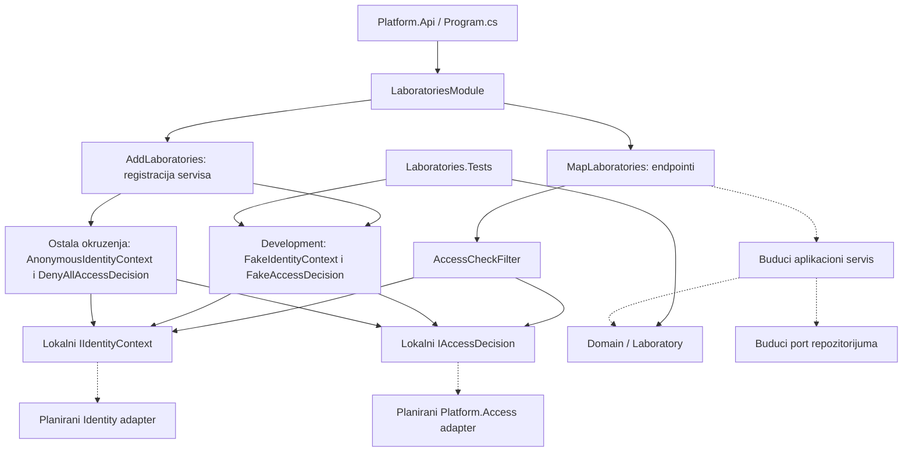
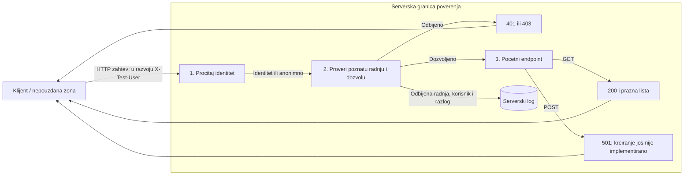
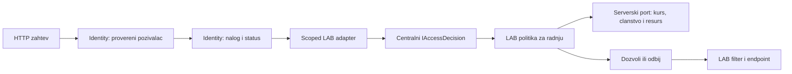

# LAB-01 / LAB-07: KT1 kostur modula Laboratories

**Grana:** `feature/LAB-01-skeleton`

**Dodeljeni zahtevi:** LAB-01 (trajni identitet laboratorije), LAB-07 (lokalizacija i pristupacne varijante).

## Odgovornosti i trenutno stanje

Ovaj dokument opisuje trenutno implementiran kostur. Ne predstavlja dokaz zavrsenog LAB-01 ili LAB-07.

- `Domain/Laboratory` cuva trajni `Id` i validiran `Title`. Konstruktor za novu laboratoriju generise `Guid` na serveru; konstruktor sa postojecim ID-jem namenjen je rekonstrukciji na serveru. Buduci API ne sme mapirati klijentski ID u taj konstruktor.
- `Rename()` cuva ID. Naslov je obavezan, normalizuje se uklanjanjem okolnih razmaka i ima najvise 200 znakova.
- `Application` definise lokalne portove `IIdentityContext`, `IAccessDecision` i poznate radnje `laboratory.list` i `laboratory.create`.
- `Api` sadrzi pocetne endpoint-e i serverski filter pristupa. Domen jos nije povezan sa endpoint-ima niti skladistem.
- `Infrastructure` sadrzi razvojne fake implementacije i implementacije koje odbijaju pristup van Development okruzenja.
- `LaboratoriesModule` registruje servise kroz `AddLaboratories` i rute kroz `MapLaboratories`, uz ocuvane registracije ostalih modula u `Program.cs`.
- `backend/Laboratories.Tests` je ukljucen u zajednicki `backend/SecurityLab.slnx`.

Nisu implementirani: stvarno kreiranje/citanje/preimenovanje preko API-ja, repozitorijum, veza sa kursom, revizije, prevodi, evaluator i frontend laboratorije. `Status`, `CreatedBy` i `CreatedAt` iz timskog plana takodje ostaju naredni korak domena.

## Dijagram arhitekture

Puna strelica oznacava postojecu vezu, isprekidana planiranu integraciju.



Lokalni interfejsi su portovi ovog modula, a ne nove zamene za zajednicke ugovore. `Platform.Access.Contracts.IAccessDecision` koristi asinhroni `AccessRequest`; Identity ima odvojene ugovore za pozivaoca zahteva i za pronalazenje naloga. Potrebni su eksplicitni adapteri, mapiranje identifikatora i konteksta kursa. Samo podudaranje imena interfejsa nije integracija.

## DFD: trenutni zahtev i granica poverenja



Trenutno nema skladista laboratorija niti upisa u bazu; serverski log je jedino prikazano odrediste zapisa. Domen se proverava direktno kroz testove. U buducem toku aplikacioni servis posle autorizacije validira podatke, menja domen i upisuje kroz repozitorijum.

`X-Test-User` je simulacija, ne dokaz stvarnog identiteta: klijent moze sam poslati `marko:Teacher`. Fake prihvata sintakticki ispravan identifikator i poznatu ulogu, bez provere registra korisnika. Nepostojece ime sa poznatom ulogom zato nije dokazano odbijeno. Bez zaglavlja, sa neispravnim formatom ili nepoznatom ulogom identitet ostaje anoniman. Test `Decide_WhenUserIsUnknown_Denies` proverava anonimni subjekat, ne pretragu korisnickih naloga. Fake se registruje samo u Development okruzenju; van njega pristup laboratorijama se odbija.

## Granice prema drugim timovima

| Modul / zahtev | Vlasnistvo i dogovor za povezivanje |
| --- | --- |
| Tim 11, AUT-01 / AUT-06 | `Platform.Authoring` poseduje nacrte, njihove izmene i kopiranje sablona. LAB-01 poseduje trajni identitet laboratorije. Planirana veza nacrta sa `LaboratoryId` mora biti dogovorena sa timom 11; trenutno je nema. Ne uvoditi drugi authoring servis u LAB modul. |
| Tim 11, verzije i naslov | `LabDraft.Version` je kontrola konkurentnih izmena, ne broj objavljene revizije. Njihov naslov sadrzaja ima limit 120, a trenutni LAB naslov 200 znakova. Pre povezivanja dogovoriti jedinstvena pravila prenosa i izvor naslova; ne kopirati tekst automatski u dva nezavisna modela. |
| LAB-02, PR #43 | `Platform.LabMetadata.Laboratory` takodje sadrzi ID i preimenovanje. Pre integracije usaglasiti zajednicki model ili vezu metapodataka preko trajnog `LaboratoryId`; ne stvarati drugi identitet za istu laboratoriju. PR nije ukljucen u ovu granu. |
| LAB-06, PR #41 | Preduslovi treba da referenciraju trajni `LaboratoryId`. Ovaj modul ne preuzima proveru zavrsenosti i ciklusa. PR nije ukljucen u ovu granu. |
| Identity i Access | Koristiti njihove javne ugovore kroz adaptere. Razvojna globalna uloga nije zamena za proveru clanstva i prava nad konkretnim kursom/resursom. Ne menjati registracije drugih timova da bi fake laboratorije radio. |
| REV | Izdavanje broja i nepromenljivog snapshot-a pripada objavljivanju (REV-01). Eventualna minimalna revizija za KT1 mora biti jasno oznacena kao demonstraciona dok se ne dogovori zajednicki ugovor. |
| AUT-04, PR #44 | LAB-07 bira prevod dozvoljenog javnog sadrzaja. Ne preuzima kontrolu pristupa evaluator kljucevima. PR nije ukljucen u ovu granu. |
| LAB-07 | Buduci sr/en tekst referencira isti `RevisionId` i isti evaluator. Promena jezika ne stvara novu reviziju niti menja ocenjivanje. Implementacija jos ne postoji. |

Navedene granice su predlog integracije na osnovu postojeceg koda, a ne potvrda saglasnosti drugih timova. Njihovi fajlovi nisu menjani radi ove dokumentacije.

## Bezbednosne provere i ogranicenja

- Filter radi na serveru pre endpoint-a. Anonimni identitet dobija 401, nedozvoljena radnja 403.
- Nepoznata radnja se odbija; student ne moze da prodje proveru kreiranja, nastavnik moze da dodje do jos neimplementiranog POST-a (501).
- `LaboratoryTests` proverava generisanje ID-ja, ocuvanje ID-ja pri preimenovanju, prazne/preduge naslove, granicnu duzinu i ocuvanje stanja pri odbijenoj promeni.
- `LaboratoriesHttpTests` pokrece stvarni API host u memoriji: proverava 200/401/403/501, odbijanje neispravnog i visestrukog identitetskog zaglavlja, izolaciju identiteta izmedju zahteva i odbijanje test nastavnika u Production i Staging okruzenju. Host koristi postojece registracije modula; testovi ne zamenjuju LAB provere prava.
- Kontrola pristupa trenutno je razvojna simulacija, bez stvarne sesije, kursa, vlasnistva ili provere statusa naloga. Testovi tog stvarnog integracionog toka ostaju naredni korak.
- Putanja kostura je `/api/laboratories/`. Timski plan za API navodi `/api/labs`; kanonsku putanju treba usaglasiti pre dodavanja narednih endpoint-a i frontenda.

## Pokretanje i kratka demonstracija

Potreban je .NET SDK 10. Komande se pokrecu iz korena repozitorijuma. Za ovaj kostur nije potrebna baza laboratorija niti Docker. Ostali moduli mogu zahtevati svoju konfiguraciju.

```powershell
dotnet build backend/SecurityLab.slnx --configuration Release
dotnet test backend/SecurityLab.slnx --configuration Release --no-build

$env:ASPNETCORE_ENVIRONMENT = 'Development'
dotnet run --project backend/Platform.Api/Platform.Api.csproj --no-launch-profile --urls http://localhost:5080
```

U drugom terminalu, uz slobodan port 5080:

```powershell
# Bez identiteta: 401
curl.exe -i http://localhost:5080/api/laboratories/

# Razvojni student cita pocetnu praznu listu: 200
curl.exe -i -H "X-Test-User: ana:Student" http://localhost:5080/api/laboratories/

# Razvojni student ne sme da kreira: 403
curl.exe -i -X POST -H "X-Test-User: ana:Student" http://localhost:5080/api/laboratories/

# Razvojni nastavnik prolazi proveru, ali kreiranje jos ne postoji: 501
curl.exe -i -X POST -H "X-Test-User: marko:Teacher" http://localhost:5080/api/laboratories/
```

### Izvrsena lokalna provera

Provera je izvrsena 3. novembra 2026. nad trenutnim lokalnim izmenama, u Development okruzenju, na `http://127.0.0.1:5080`, sa .NET SDK 10.0.403. API je pokrenut iz Release builda sa `--no-build --no-restore --no-launch-profile`. Koriscena je postojeca razvojna konfiguracija, bez `X-Stub-User` zaglavlja i bez konekcije sa bazom laboratorija. API je posle provere zaustavljen.

| Zahtev | X-Test-User | Dobijeno | Tumacenje |
| --- | --- | --- | --- |
| GET `/api/health` | nema | 200 | API je dostupan. |
| GET `/api/laboratories/` | nema | 401 | Anonimni zahtev je odbijen. |
| GET `/api/laboratories/` | `ana:Student` | 200, `[]` | Pocetni prikaz, bez podataka iz skladista. |
| POST `/api/laboratories/` | `ana:Student` | 403 | Student je odbijen na serveru. |
| POST `/api/laboratories/` | `marko:Teacher` | 501 | Provera prava prolazi, kreiranje nije implementirano. |
| GET `/api/laboratories/` | `ana:Unknown` | 401 | Nepoznata uloga je odbijena. |
| GET `/api/laboratories/` | `invalid` | 401 | Neispravan format identiteta je odbijen. |
| POST `/api/laboratories/` | `not-a-real-account:Teacher` | 501 | Potvrdjeno ogranicenje fake-a: ne proverava postojanje naloga. |

Frontend je proveren komandama `npm ci --no-audit --no-fund` i `npm run build` iz `frontend/`: TypeScript provera i Vite build su prosli. Ovo nije dokaz funkcionalnog LAB frontenda: taj deo jos nije implementiran, niti je radjena provera pristupacnosti u browseru.

HTTP provere su rucni lokalni smoke testovi, nisu automatizovani integracioni testovi niti GitHub CI rezultat. Zajednicki middleware drugih modula i njihova razvojna konfiguracija mogu uticati na zahteve u drugim okruzenjima.

## Konkretan predlog Identity/Access integracije

Ovo je predlog naredne izmene, jos nije implementiran niti usaglasen sa vlasnicima ugovora. Postojeci kod Identity/Access modula ostaje nepromenjen.

### Postojeci ugovori koje treba koristiti

| Potreba | Postojeci ugovor | Ogranicenje trenutnog stanja |
| --- | --- | --- |
| Identitet pozivaoca | `Platform.Api.Services.Identity.IIdentityContext.Current` | Development koristi `X-Stub-User`, ostala okruzenja anonimnu implementaciju. To jos nije stvarna autentifikovana sesija. |
| Postojanje i status naloga | `Platform.Identity.Contracts.IIdentityContext.FindByIdAsync(Guid, CancellationToken)` | Deklaracija postoji; u pregledanom kodu nije nadjena implementacija ni DI registracija ovog ugovora. Samo registrovanje Identity modula ne obezbedjuje ovaj lookup. |
| Odluka o pristupu | `Platform.Access.Contracts.IAccessDecision.DecideAsync(AccessRequest, CancellationToken)` | Centralni servis vec odbija anonimnog/neaktivnog subjekta, nepoznatu radnju, nedostajucu politiku i gresku politike. |
| Kontekst zahteva | `AccessRequest(Subject, Action, Resource, CorrelationId)` | `SubjectRef` ima ID i status, bez uloge. `ResourceRef` ima samo tip i ID, bez posebnog `CourseId` polja. |
| Politika i registracija | `IAccessPolicy`, `InMemoryActionCatalog.Register`, `InMemoryAccessPolicyRegistry.Register` | Registracija ide jednom pri pokretanju, kao postojeci `RegisterIdentityAccess`; oba registra odbijaju duplikate. |

`IRequestSubjectResolver` trenutno koristi razvojni ID iz konfiguracije ili vraca anonimnog subjekta; ne daje ulogu niti proveru naloga. Zato se ne koristi kao dovoljan dokaz stvarnog identiteta. Takodje, sinhroni LAB port `Decide` ne treba povezivati sa asinhronim Access servisom preko `.Result` ili `.GetAwaiter().GetResult()`.

### Predlozene izmene samo unutar LAB modula

1. Dodati scoped adapter u LAB `Infrastructure` koji cita pozivaoca kroz Identity ugovor, zatim asinhrono proverava postojanje i status naloga. Prazan/nepoznat ID, neautentifikovana sesija ili nedostupan podatak ne smeju dati dozvolu. Status mapirati eksplicitno (`Active`, `Blocked`, `Archived`), bez cast-a izmedju enum-a i bez podrazumevanog `Active`.
2. Prevesti lokalni LAB port i filter na asinhroni tok i proslediti `HttpContext.RequestAborted`. Uloga iz klijentskog zaglavlja se ne prenosi u stvarnu politiku. Adapter poziva postojeci `Platform.Access.Contracts.IAccessDecision` sa korelacionim ID-jem iz `HttpContext.TraceIdentifier`.
3. Dodati LAB implementacije `IAccessPolicy` za `laboratory.list` i `laboratory.create`. Jednokratnu registraciju radnji/politika obaviti kroz LAB composition metodu posle `builder.Build()`, uz jednu dodatnu liniju u hostu. Ne menjati centralne Access registre, postojece politike ili njihove registracije.
4. Za listanje i kreiranje vezano za kurs koristiti `ResourceRef("course", courseId)` i serverski izvor clanstva. Za citanje/preimenovanje postojece laboratorije koristiti `ResourceRef("laboratory", laboratoryId)`; politika preko javnog porta pronalazi kurs i proverava prava. Klijent moze zahtevati ID kursa/resursa, ali server proverava da taj kontekst stvarno pripada resursu i pozivaocu.
5. Ako ugovor za clanstvo/kontekst kursa jos nije dostupan, LAB politika ostaje odbijajuca. Ne dozvoljavati svim korisnicima samo zato sto je nalog aktivan. Naziv i potpis porta za clanstvo usaglasiti sa Access/Course timom; postojeci ugovori nemaju taj podatak.
6. HTTP mapiranje: odsutan/neprihvatljiv identitet vraca 401; autentifikovan pozivalac bez dozvole 403. Detaljne Access razloge zadrzati na serveru. Gresku infrastrukture ne prikazivati kao uspesnu autorizaciju; bezbedan odgovor i eventualni 503 usaglasiti sa API pravilima.
7. Fake implementacije izdvojiti iza eksplicitne razvojne konfiguracije, uz zabranu njihovog ukljucivanja van Development okruzenja. Integracioni rezim nema automatski povratak na fake ako nedostaje pravi servis. Dok zavisnosti nisu dostupne, trenutni KT1 demo ostaje jasno oznacen kao simulacija.

Centralni Access servis je singleton. Registrovana politika ne sme direktno zadrzati scoped Identity/DbContext ili trenutni HTTP zahtev. Lifetime buduce politike i nacina pristupa clanstvo/resurs podacima treba usaglasiti sa Access timom pre implementacije; ukljuciti DI scope validation test. Ne menjati centralni servis u scoped niti koristiti root provider za scoped servise bez tog dogovora.

### Predlozeni tok posle integracije



Sve veze u ovom dijagramu predstavljaju predlog, ne trenutno izvrsavanje.

### Kriterijumi pre ukljucivanja adaptera

- Identity tim potvrdi izvor pozivaoca, proveru sesije/statusa i obezbedi account lookup implementaciju ili dogovoreni ekvivalent.
- Access/Course tim potvrdi izvor clanstva, resource kontekst i lifetime politika. Bez tih podataka integracija ostaje odbijajuca.
- Automatizovani HTTP testovi dokazuju: anonimni/nepoznat nalog se odbija; blokiran/arhiviran nalog se odbija; student ne kreira; nastavnik dozvoljenog kursa moze; nastavnik drugog kursa ne moze; nepoznata radnja i nedostajuca politika se odbijaju.
- Dodatno proveriti: pokusaj slanja `X-Test-User` u integracionom rezimu ne daje privilegije, otkazivanje zahteva se propagira, nema dvostruke registracije radnji, DI scope validation prolazi i testovi drugih timova ostaju zeleni.
- Endpoint za stvarno kreiranje ima svoj pozitivan kriterijum (201 i serverski ID); danasnji 501 nije taj dokaz.

## Dokazi rada i sledeci koraci

- Kod: `backend/Platform.Api/Modules/Laboratories/`, testovi: `backend/Laboratories.Tests/`.
- Zajednicki CI koristi `backend/SecurityLab.slnx`; LAB test projekat je sada ukljucen.
- Lokalna provera 3. novembra 2026, .NET SDK 10.0.403: `dotnet test backend/SecurityLab.slnx --configuration Release` je prosao. Izvrseno je 199 testova: Laboratories 31 (ukljucujuci 13 HTTP slucajeva), Authoring 55, Audit 71 i Platform.Tests 42; nema neuspesnih ili preskocenih testova. To je rezultat trenutnih lokalnih izmena, ne GitHub CI provere.
- Individualni doprinos prikazati stvarnim commit-ima/PR-om svakog clana. Ovaj dokument ne pripisuje nepotvrdjeno autorstvo.
- Pre push-a izvrsiti build/test, proveriti diff i dogovoriti preostale integracione ugovore. PR jos nije otvoren.
- Naredno: adapteri i HTTP testovi stvarnog identiteta i konteksta kursa, usaglasavanje modela sa LAB-02 i timom 11, repozitorijum, revizije i LAB-07 prevodi/pristupacnost.
