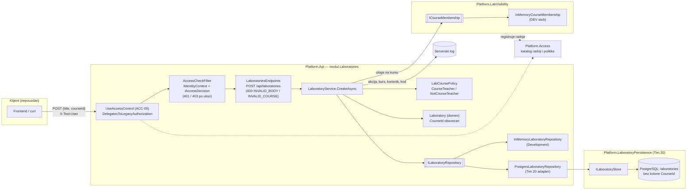
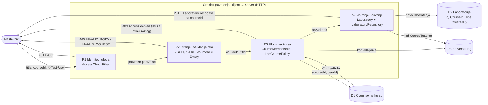
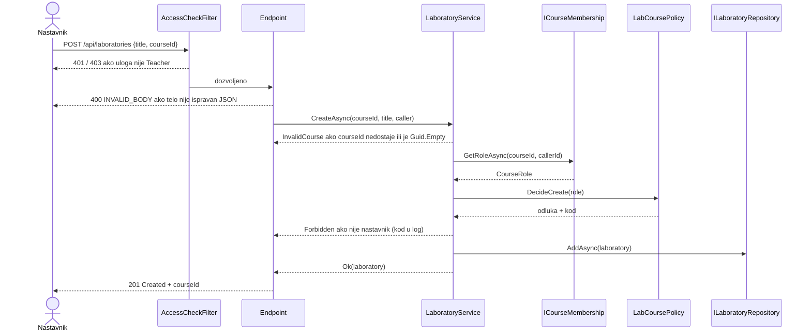

# Komponenta projekta: LAB-03 model veze laboratorija–kurs

**Tim:** Tim 13

**Student:** Mihailo Vojinović / PR84-2021

**Zahtevi iz specifikacije:** LAB-03 (Ј) — vezivanje laboratorije za kurs; kriterijum: nije moguce otvoriti laboratoriju van dozvoljenog konteksta. Zajednicki zahtevi koje ovaj deo pokriva: SEC-01 (serverska autorizacija, IDOR), SEC-05 (validacija ulaza), ACC-04 (autorizacija nad konkretnim resursom), ACC-05 (podrazumevano odbijanje), OPS-07 (poruke o gresci bez tajni).

**Grana:** `feature/LAB-03-model-kursa`

## Odgovornosti i granice

- **Procesi i scenariji:** nastavnik pravi laboratoriju na kursu na kome predaje (`POST /api/laboratories` sa `courseId`). Laboratorija ne moze da nastane bez kursa, a kurs se posle kreiranja ne menja.
- **Sta ovaj deo radi:**
  - `Laboratory.CourseId` (`Guid`, nepromenljiv; `Guid.Empty` se odbija u konstruktoru i u `Rehydrate`).
  - `LabCoursePolicy.DecideCreate(CourseRole)` — samo `Teacher` na tom kursu sme da kreira; svaki ishod ima stabilan kod (`CourseTeacher`, `NotCourseTeacher`).
  - `LaboratoryService.CreateAsync` pita `ICourseMembership` za ulogu pozivaoca bas na trazenom kursu.
  - `InMemoryLaboratoryRepository` cuva `CourseId`; `LaboratoryResponse` ga vraca.
  - Development podaci: dva demo kursa u `Program.cs`.
- **Sta ovaj deo NE radi:** ne proverava kontekst pri otvaranju laboratorije, ne menja PostgreSQL skladiste (Tim 20), ne menja frontend (vidi Otvorene stavke), ne upisuje dogadjaj u `Platform.Audit`.
- **Ugovori sa drugim delovima:**
  - `ICourseMembership` iz `Platform.LabVisibility.Contracts` (dogovoreno; privremeni ugovor dok ACC ne objavi clanstvo).
  - `ILaboratoryRepository` (LAB-01) — ugovor se ne menja, samo `Laboratory` nosi `CourseId`.
  - `IIdentityContext` / `IAccessDecision` (LAB-01) — prva provera po platformskoj ulozi ostaje u `AccessCheckFilter`.
- **Stanje implementacije:** kreiranje sa kursom je implementirano i pokriveno jedinicnim i HTTP testovima. PostgreSQL jos ne cuva `CourseId` (vidi Zahtev za Tim 20).

## Dijagram arhitekture



- `LaboratoryService` zavisi samo od ugovora (`ICourseMembership`, `ILaboratoryRepository`), ne od tehnickih adaptera.
- `LabCoursePolicy` nema zavisnosti: ulaz je uloga, izlaz je odluka sa kodom. Zato se testira bez HTTP-a i bez skladista.
- Kada ACC objavi pravi ugovor za clanstvo, menja se samo registracija `ICourseMembership`; servis i politika ostaju isti.

## DFD: kreiranje laboratorije na kursu



Pretpostavke na granici (koje mogu biti pogresne):

- `courseId` dolazi od klijenta i nije pouzdan: server ga ne prihvata dok ne proveri ulogu bas na tom kursu (P3).
- Identitet u Development rezimu dolazi iz `X-Test-User` zaglavlja (fake). Van Development rezima niko nije prepoznat (`AnonymousIdentityContext`), pa se zahtev odbija pre P2.
- D1 je u Development rezimu stub u memoriji; tacnost clanstva zavisi od ACC modula.

### Sekvenca POST zahteva



## Provera konteksta pri otvaranju (Vojin)

Biće dopunjeno.

## Bezbednosni zahtevi

- **Provere na serveru:** dve provere, redom:
  1. `AccessCheckFilter`: platformska uloga `Teacher` za `laboratory.create`.
  2. `LaboratoryService`: uloga na trazenom kursu kroz `ICourseMembership` i `LabCoursePolicy`.
  Provera kursa je pre provere naslova, pa ko nije nastavnik ne dobija ni gresku validacije naslova.
- **Validacija ulaza:** `courseId` je obavezan; nedostaje ili `Guid.Empty` daje `400 INVALID_COURSE`. Neispravan Guid u JSON-u daje `400 INVALID_BODY` (postojece citanje tela iz LAB-01). Domen dodatno odbija `Guid.Empty` (`ArgumentException`), pa laboratorija bez kursa ne moze nastati ni zaobilazenjem servisa.
- **Mass assignment:** `RenameLaboratoryRequest` nema `CourseId`, a `UpdateAsync` ne menja kurs; laboratorija se ne moze premestiti na drugi kurs.
- **Osetljivi podaci:** odbijanje vraca isti `403 Access denied` za nepostojeci kurs, kurs na kome korisnik nije clan i kurs na kome je student. Odgovor ne sadrzi ID kursa ni ulogu. Razlog (`NotCourseTeacher`) se pise samo u serverski log, uz radnju, kurs i korisnika; bez tajni.
- **Negativni scenariji:** vidi tabele ispod.

### Pretnja → kontrola → test → dokaz

| Pretnja | Kontrola | Test |
| --- | --- | --- |
| Nastavnik menja `courseId` u telu i pravi laboratoriju na tudjem kursu (IDOR) | Uloga se proverava bas na trazenom kursu | `PostLabs_WhenTeacherSwapsCourseId_Returns403AndStoresNothing`, `Create_WhenTeacherUsesCourseNotTaught_ReturnsForbiddenAndStoresNothing` |
| Nastavnik koji nije clan kursa pravi laboratoriju | Podrazumevano odbijanje u `LabCoursePolicy` | `PostLabs_WhenTeacherIsNotMemberOfCourse_Returns403AndStoresNothing`, `DecideCreate_WhenNotTeacherOnCourse_Denies` |
| Oslanjanje samo na globalnu ulogu (nastavnik na platformi, student na kursu) | Odlucuje uloga na kursu | `Create_WhenCallerIsStudentOnCourse_ReturnsForbiddenEvenWithTeacherPlatformRole` |
| Student pravi laboratoriju | Filter po ulozi + politika kursa | `PostLabs_WhenStudentCreates_Returns403AndStoresNothing` |
| Nabrajanje kurseva preko razlicitih odgovora | Isti 403 za svaki razlog | `PostLabs_DenialIsSameForExistingAndUnknownCourse` |
| Laboratorija van kursa (van dozvoljenog konteksta) | `courseId` obavezan u API-ju i domenu | `PostLabs_WithoutCourse_Returns400AndStoresNothing`, `Create_WithEmptyCourse_Throws`, `Rehydrate_WithEmptyCourse_Throws` |
| Premestanje laboratorije na drugi kurs kroz PATCH | Ugovor bez `CourseId`, kurs nepromenljiv | `PatchLabTitle_CannotChangeIdCreatorOrCourseThroughBody`, `Rename_KeepsCourse` |
| Nepoznata uloga daje pristup | Podrazumevano odbijanje | `DecideCreate_WithUnknownRole_DeniesByDefault` |

Preostali rizik: dok Tim 20 ne doda kolonu, PostgreSQL ne cuva `CourseId` (vidi ispod); clanstvo je DEV stub; nema dogadjaja u `Platform.Audit`.

### Test scenariji (format iz specifikacije 8.1)

| Requirement ID | Preduslov | Akcija | Ocekivano | Dokaz (test) |
| --- | --- | --- | --- | --- |
| LAB-03 | marko je nastavnik na kursu C | POST sa `courseId = C` | 201, `courseId = C` u odgovoru i skladistu | `PostLabs_WhenTeacherCreatesOnOwnCourse_Returns201WithCourse`, `Create_WhenCallerTeachesCourse_StoresCourse` |
| LAB-03 | nastavnik | POST bez `courseId` / sa `Guid.Empty` | 400 `INVALID_COURSE`, nista sacuvano | `PostLabs_WithoutCourse_Returns400AndStoresNothing`, `Create_WithoutCourse_ReturnsInvalidCourseAndStoresNothing` |
| LAB-03 | jelena (Teacher) nije clan kursa C | POST sa `courseId = C` | 403, nista sacuvano | `PostLabs_WhenTeacherIsNotMemberOfCourse_Returns403AndStoresNothing` |
| LAB-03 | ana je studentkinja na kursu C | POST sa `courseId = C` | 403, nista sacuvano | `PostLabs_WhenStudentCreates_Returns403AndStoresNothing` |
| LAB-03, SEC-01 | marko nije clan kursa D | POST sa `courseId = D` | 403, nista sacuvano | `PostLabs_WhenTeacherSwapsCourseId_Returns403AndStoresNothing` |

Rezultat: `dotnet test backend/SecurityLab.slnx` — `Laboratories.Tests` 134/134 prolazi (2026-11-05, grana `feature/LAB-03-model-kursa`).

## Zahtev za Tim 20 (Platform.LaboratoryPersistence)

Ovaj deo **ne menja** `Platform.LaboratoryPersistence`. Da bi PostgreSQL cuvao kurs, potrebno je:

1. `StoredLaboratory` (`Application/StorageContracts.cs`): dodati `Guid CourseId`.
2. `LaboratoryRecord`: dodati `public Guid CourseId { get; set; }`.
3. `LaboratoryConfiguration`: `builder.Property(x => x.CourseId).IsRequired();` i `builder.HasIndex(x => x.CourseId);` (pretraga laboratorija po kursu).
4. `PostgresLaboratoryStore`: upisati `CourseId` u `AddAsync` i procitati ga u `ToStored`. `UpdateAsync` **ne sme** da menja `CourseId` (isto kao `CreatedBy`).
5. Migracija `AddLaboratoryCourseId` nad tabelom `laboratories`, kolona `CourseId uuid`:
   - postojeci redovi nemaju kurs: kolonu prvo dodati kao nullable, popuniti stvarnim kursom (ili ukloniti razvojne redove), pa tek onda postaviti `NOT NULL`;
   - **ne** koristiti `Guid.Empty` kao podrazumevanu vrednost (to bi bila laboratorija van kursa);
   - spoljni kljuc ka tabeli kurseva dodati kada ACC objavi svoju tabelu.
6. Posle toga u `PostgresLaboratoryRepository` (Platform.Api): proslediti `laboratory.CourseId` u `StoredLaboratory` i citati preko `Laboratory.Rehydrate(id, courseId, ...)`. Tada se brise privremeni `Rehydrate` bez kursa iz `Laboratory.cs`.

Do tada: `PostgresLaboratoryRepository` nije menjan. Ucitava laboratorije kroz privremeni `Rehydrate` bez kursa (`CourseId = Guid.Empty`), a pri upisu se `CourseId` ne cuva. Takva laboratorija nema kurs, pa je provera pri otvaranju odbija.

Jedina izmena u kodu Tima 20 je jedna linija u testu (`Platform.LaboratoryPersistence.Tests/LaboratoryPersistenceIntegrationTests.cs`, `NewLab`), jer konstruktor `Laboratory` sada trazi kurs; bez nje se resenje ne kompajlira.

## Otvorene stavke

- **Frontend (`frontend/src/api/labs.ts`, `createLab`) — nije menjan.** Salje samo `{ title }`, pa posle ove izmene kreiranje sa frontenda dobija `400 INVALID_COURSE`. `createLab` koristi i tim za LAB-07. Plan migracije (OPS-08: ne ukidati javni ugovor bez plana):
  1. dogovor sa LAB-07 timom oko izvora `courseId` (izbor kursa u formi ili kurs iz konteksta stranice);
  2. `createLab(title, courseId, user)` salje `{ title, courseId }`;
  3. poruka za `INVALID_COURSE` u mapi gresaka;
  4. frontend testovi za 400 i 403.
  Do tada backend i frontend nisu uskladjeni; spajanje u main treba uskladiti sa tim izmenama.
- **Audit:** `Platform.Audit` ima `access.denied`, ali `denialReason` dozvoljava samo `unauthenticated`, `account_not_active`, `unknown_action`, `no_policy`, `policy_error`. Predlog Audit timu: dodati razlog npr. `course_role_insufficient`. Do tada se odluka pise u serverski log.
- **Globalna uloga:** `FakeAccessDecision` i dalje trazi platformsku ulogu `Teacher` za `laboratory.create`. Specifikacija (poglavlje 2) razlikuje ulogu po kursu od globalnog statusa; konacnu odluku po kursu donosi ACC.
- **Status upisa i stanje kursa:** `ICourseMembership` vraca samo ulogu. Aktivan upis (ACC-21) i arhiviran kurs (ACC-02) se ne proveravaju; to zavisi od ACC ugovora.

## Dokaz rada

- **Fajlovi:**
  - `backend/Platform.Api/Modules/Laboratories/Domain/Laboratory.cs`
  - `backend/Platform.Api/Modules/Laboratories/Application/LabCoursePolicy.cs` (nov)
  - `backend/Platform.Api/Modules/Laboratories/Application/LaboratoryService.cs`
  - `backend/Platform.Api/Modules/Laboratories/Api/LaboratoryContracts.cs`, `LaboratoriesEndpoints.cs`
  - `backend/Platform.Api/Modules/Laboratories/Infrastructure/InMemoryLaboratoryRepository.cs`
  - `backend/Platform.Api/Program.cs` (samo Development podaci)
  - `backend/Laboratories.Tests/*` (`LabCoursePolicyTests.cs` nov)
- **Pokretanje testova** (iz korena repozitorijuma, .NET SDK 10):

  ```powershell
  dotnet build backend/SecurityLab.slnx
  dotnet test backend/SecurityLab.slnx
  ```

- **Rucna demonstracija** (Development):

  ```powershell
  # nastavnik 1111 na prvom demo kursu -> 201 sa courseId
  curl.exe -i -X POST http://localhost:5080/api/laboratories `
    -H "Content-Type: application/json" `
    -H "X-Test-User: 11111111-1111-1111-1111-111111111111:Teacher" `
    -d '{\"title\":\"Kontrola pristupa\",\"courseId\":\"aaaaaaaa-aaaa-aaaa-aaaa-aaaaaaaaaaaa\"}'

  # isti nastavnik na drugom kursu (nije nastavnik) -> 403
  curl.exe -i -X POST http://localhost:5080/api/laboratories `
    -H "Content-Type: application/json" `
    -H "X-Test-User: 11111111-1111-1111-1111-111111111111:Teacher" `
    -d '{\"title\":\"Kontrola pristupa\",\"courseId\":\"bbbbbbbb-bbbb-bbbb-bbbb-bbbbbbbbbbbb\"}'

  # bez kursa -> 400 INVALID_COURSE
  curl.exe -i -X POST http://localhost:5080/api/laboratories `
    -H "Content-Type: application/json" `
    -H "X-Test-User: 11111111-1111-1111-1111-111111111111:Teacher" `
    -d '{\"title\":\"Kontrola pristupa\"}'
  ```

  Demo podaci: kurs `aaaa…` (1111 nastavnik, 2222 student), kurs `bbbb…` (3333 student).
- **Sledeci koraci:** Tim 20 kolona i migracija; frontend `createLab` sa LAB-07 timom; audit razlog sa Audit timom; zamena `InMemoryCourseMembership` pravim ACC ugovorom.
