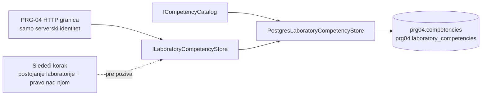

# PRG-04 — Model kompetencija, čuvanje veza i identitetski API

## Obim do sada

Specifikacija, odeljak 4.10: **PRG-04 — Mapiranje laboratorija na kompetencije**.
Minimalni kriterijum: jedna vežba može proveravati više kompetencija.

Implementiran je samostalan `Platform.Competencies` modul i njegov test projekat.
Prva priča obuhvata model, početni katalog i PostgreSQL skladište. Drugi, namerno
ograničen korak, dodaje HTTP operacije i proverava samo da li server poznaje
identitet pozivaoca. Nema frontend-a, uređivanja kataloga, provere usvojenosti
kompetencija, ocenjivanja, promene revizija ili pokušaja.

## Model i pravila

- `Competency`: stabilni `Id`, obavezan naziv (do 120 znakova) i opcioni kratak
  opis (do 500 znakova). Ovo su ograničenja implementacije, a ne dodatni zahtevi specifikacije.
- `LaboratoryCompetency`: par `LaboratoryId` / `CompetencyId`. Jedna laboratorija
  ima 0..N veza, a ista kompetencija može se koristiti u više laboratorija.
- `LaboratoryId` je referenca na već postojeći trajni identitet laboratorije,
  bez kopije modela laboratorije i bez veze sa određenom revizijom ili pokušajem.
- Složeni primarni ključ sprečava duplikate. Ponovljeno ili istovremeno dodavanje
  iste veze je idempotentno: samo jedan poziv dodaje red, ostali vraćaju `false`.
- Uklanjanje briše samo navedenu vezu; katalog, ostale veze i druge laboratorije
  ostaju sačuvani. Uklanjanje nepostojeće veze vraća `false`.
- Prazni ID-evi i nepostojeća kompetencija se odbijaju. Baza dodatno proverava
  ključ, referencu na kompetenciju i neprazan ID laboratorije.

Početni katalog ima tri primera: **Kontrola pristupa**, **Analiza bezbednosnih
logova** i **Bezbedna konfiguracija**. ID-evi su eksplicitne konstante u
`BuiltInCompetencies`; postojeći ID ne sme se regenerisati pri preimenovanju.
Katalog se inicijalizuje migracijom i nema aplikacioni ugovor za njegovo uređivanje.

## Granice i ugovori

`ICompetencyCatalog.ListAsync` čita katalog. `ILaboratoryCompetencyStore` nudi
`AddAsync`, `RemoveAsync` i `GetForLaboratoryAsync`. Upiti su parametrizovani;
čitanje veza je ograničeno na prosleđeni ID laboratorije.

Skladište je **interni port**, a ne autorizovan slučaj upotrebe. Ne proverava
postojanje laboratorije ili identitet pozivaoca. Za laboratoriju bez veza vraća
praznu listu; ne razlikuje je od nepostojećeg ID-a.

HTTP granica u ovom koraku proverava postojeći serverski sesijski identitet: bez
aktivne sesije i važećeg, nepraznog ID-a vraća `401`. Namera je isključivo da se
ne dozvoli anoniman poziv. Svesno **ne**
proverava da li `LaboratoryId` postoji niti pravo prijavljenog korisnika nad tom
laboratorijom. Zato bilo koji prijavljeni korisnik trenutno može da pročita ili
promeni veze za bilo koji sintaksno važeći ID laboratorije. To nije završna
autorizacija i mora biti zamenjeno proverom postojanja i prava pre naredne priče.

API ugovor je:

| Metod i putanja | Ishod |
| --- | --- |
| `GET /api/competencies` | Katalog kompetencija (`200`) |
| `GET /api/laboratories/{laboratoryId}/competencies` | Veze za prosleđeni ID (`200`) |
| `PUT /api/laboratories/{laboratoryId}/competencies/{competencyId}` | Dodaje vezu (`201`), odnosno `204` ako već postoji |
| `DELETE /api/laboratories/{laboratoryId}/competencies/{competencyId}` | Idempotentno uklanja vezu (`204`) |

Prazni ID-evi vraćaju `400`, a nepoznata kompetencija pri dodavanju `404`. Ako
PostgreSQL konfiguracija za kompetencije nije dostupna, prijavljeni poziv dobija
bezbedan `503`, nikada memorijsko zamensko skladište.

Nema direktnog stranog ključa ka tuđoj tabeli laboratorija, preslikavanja tuđih
entiteta niti upisa u njihove tabele. Time prvi korak ne zahteva izmene
`Platform.LaboratoryPersistence`, članstva, Identity, LAB ili REV modula.
Provera referenciranog laboratorijskog ID-a na granici aplikacije ostaje obaveza
druge priče; samo sintaksno ispravan GUID nije dokaz postojanja ili pristupa.



Tok: HTTP poziv → provera serverski dobijenog identiteta → validacija ID-eva i
provera kataloga → parametrizovan upis/brisanje/čitanje u PRG-04 šemi → rezultat.
Rute imaju eksplicitnu oznaku da same sprovode proveru identiteta; time ih centralni
ACC middleware ne odbija pre tog handlera. Postojeći middleware za sesije proverava
sesiju pre handlera, a handler zatim ponavlja proveru razrešenog identiteta.

## Baza i migracije

Modul koristi EF Core 10 i PostgreSQL. `CompetenciesDbContext` poseduje samo:

- `prg04.competencies`;
- `prg04.laboratory_competencies`;
- svoju istoriju migracija `prg04.__EFMigrationsHistory`.

`InitialCompetencies` kreira te dve poslovne tabele i inicijalizuje katalog.
`Down` uklanja samo poslovne tabele PRG-04. Tuđe šeme i migracije se ne menjaju.
Snapshot je generisan EF Core alatom i proverava se naspram aktuelnog modela.

Registracija je eksplicitna: `services.AddCompetencyPersistence(connectionString)`.
`Platform.Api` koristi najpre `ConnectionStrings:Competencies`, a zatim postojeći
`ConnectionStrings:Laboratories` kao rezervu za isti PostgreSQL server. Bez obe
konfiguracije nema zamenskog memorijskog skladišta i API vraća `503`. Web aplikacija
ne pokreće migracije automatski.

Za primenu migracije na namenjenu lokalnu/test bazu (konekciju postaviti kroz
okruženje, bez upisivanja lozinke u repozitorijum):

```powershell
dotnet tool restore --tool-manifest dotnet-tools.json
# Postaviti PRG04_MIGRATION_CONNECTION_STRING na ciljnu PostgreSQL bazu.
dotnet ef database update --project backend/Platform.Competencies --startup-project backend/Platform.Competencies
```

## Provera i dokaz

Testovi su u `Platform.Competencies.Tests` i ne zavise od API-ja ili podataka drugih tema.
Za integracione testove postaviti `PRG04_TEST_ADMIN_CONNECTION_STRING` na PostgreSQL
instancu sa dozvolom za kreiranje test baze. Docker nije obavezan; može se koristiti
i lokalni PostgreSQL. Fixture pravi novu bazu `prg04_test_<nasumični ID>` i uklanja
samo tu bazu u završnom čišćenju. Ne izvršavati testove administratorskom konekcijom
ka produkciji. Bez konfiguracije integracioni testovi se preskaču, što ne predstavlja
dokaz prolaska provere trajnosti.

```powershell
dotnet test backend/Platform.Competencies.Tests/Platform.Competencies.Tests.csproj --configuration Release
```

| Provera | Dokaz |
| --- | --- |
| Stabilni ID-evi, naziv, opis i neispravni ID-evi | `CompetencyTests` |
| Snapshot, vlasništvo nad tabelama, SQL za migraciju i rollback, registracija | `CompetencyModelTests` |
| Najmanje dve kompetencije za laboratoriju i ponovo kreiran DI kontejner/konekcija | `TwoCompetencies_SurviveDisposingAndRecreatingApplicationServices` |
| Duplikat kroz skladište i direktan duplikat u bazi | `DuplicateLink_IsIdempotentAndDatabaseKeyAlsoRejectsDirectDuplicate` |
| Istovremeni upisi iste veze | `ConcurrentDuplicateAdds_CreateExactlyOneRelationship` |
| Uklanjanje jedne veze čuva ostale i druge laboratorije | `RemoveOneLink_PreservesOtherLinksAndSharedCatalogEntry` |
| Nepostojeća kompetencija i integritet baze | `UnknownCompetency_IsRejectedByStoreAndForeignKey`, `DatabaseConstraints_RejectEmptyLaboratoryIdAndProtectCatalogFromLinkedDeletion` |
| Ponovljena migracija i izolacija šeme | `Catalog_IsSeededAndMigrationCanRunAgainWithoutResettingLinks`, `Migration_CreatesOnlyPrg04Tables` |
| API traži identitet pre pristupa skladištu | `EveryOperation_RequiresAnIdentity_BeforeItUsesStorage` |
| API čita i menja veze bez prerane provere laboratorije/prava | `AuthenticatedCaller_CanReadCatalogAndLinks_ForAnArbitraryLaboratoryId`, `AuthenticatedCaller_CanAddAndRemoveALink_WithoutResourceAuthorization` |
| Greške API granice i nedostupno skladište | `InvalidOrUnknownIdentifiers_AreSafeHttpErrors`, `AuthenticatedCaller_Gets503WhenCompetencyPersistenceIsNotConfigured` |
| Registracija PRG-04 ruta u stvarnom hostu | `ApiEndpointCoverageTests` |

Lokalna provera 8. novembra 2026:

- Release build novog modula i test projekta: uspešan, bez upozorenja i grešaka.
- Pre API koraka: **17 prošlo, 0 neuspešnih, 0 preskočenih**; od toga 8
  integracionih testova nad stvarnim PostgreSQL 17.
- Posle API koraka, bez podešene test PostgreSQL konekcije: **15 prošlo, 0
  neuspešnih, 8 preskočenih**. Preskočeni su samo raniji PostgreSQL testovi; šest
  novih API testova je prošlo.
- Postojeći test registracije i zaštite API ruta: **2 prošlo, 0 neuspešnih**.
- Dodatna provera u dva odvojena procesa: proces A upisuje dve veze i završava se;
  novi proces B ih ponovo učitava iz baze. Obe veze su sačuvane. Privremeni pomoćni
  alat za ovu proveru i generisanje migracije nalazi se u ignorisanom `obj/prg04-tools`.
- Za proveru je korišćen zaseban privremeni PostgreSQL kontejner, nezavisno od
  projektne baze. Podaci su isključivo sintetički test-podaci.

## Sledeći korak

Sledeći PRG-04 korak je provera postojanja laboratorije i serverska autorizacija
za konkretnu laboratoriju, uz negativne testove. Ekrani za izbor i prikaz
kompetencija ostaju naredne priče.
