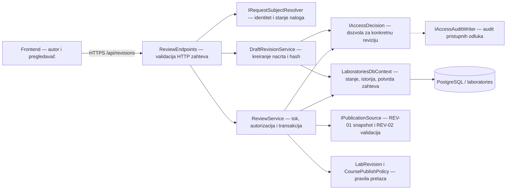
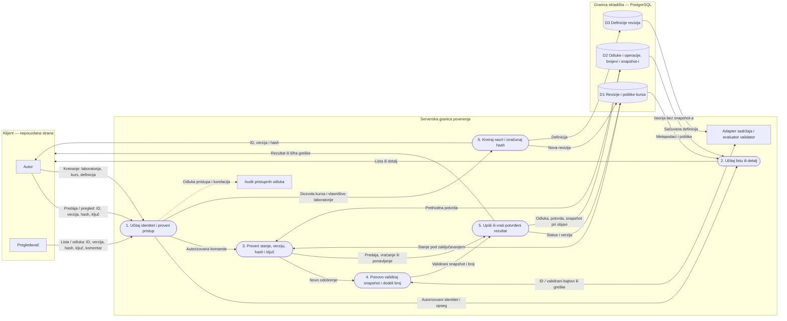

# REV-05 — slučajevi upotrebe i API

**Autor:** Marko, Tim 4. **Zahtevi:** REV-05, uz REV-01, REV-02 i SEC-01/SEC-08.

API pokriva predaju revizije, pregled, vraćanje na doradu i odobrenje. Odobrenje odmah objavljuje reviziju, u skladu sa postojećim prelazom u Matijinom domenu i očekivanjem frontenda. Aplikacija čita autora i kurs iz revizije i identitet pozivaoca iz serverskog resolvera.

## Arhitektura



## Tok podataka (DFD)



## HTTP ugovor

- `GET /api/revisions/pending-reviews?courseId=<guid>` vraća samo autorizovane revizije na pregledu. Filter kursa je opcioni i ne dodeljuje pristup.
- `GET /api/revisions/mine` i `GET /api/revisions/{id}` podržavaju postojeći prikaz liste i detalja. Bez dozvole za detalj vraća se `404`.
- `POST /api/revisions/{id}/submit|approve|return` koristi `Idempotency-Key` (1–128 ASCII slova, cifara, crtica ili donjih crta), `rowVersion` kao decimalni string i `contentHash` kao 64 mala heksadecimalna znaka. `return` zahteva komentar do 1000 znakova nakon trimovanja.
- `409 revision_changed` označava zastarelu verziju ili drugi hash. `409 idempotency_key_reused` označava ponavljanje ključa sa promenjenim zahtevom. `422 validation_failed` vraća greške validatora. `503 publication_unavailable` označava da nema pouzdanog sadržaja za objavu.
- Ponovljeni uspešan zahtev istog aktera za istu reviziju vraća stanje i istoriju do originalne operacije, uz trenutno izračunate dozvole. Provera pristupa važi i pri ponavljanju. Ključ, verzija, odluka, komentar i rezultat ostaju upisani posle restarta.

`FOR UPDATE` zaključava red revizije, `FOR SHARE` štiti politiku tokom odluke, a EF proverava `RowVersion`. Pri objavi se SHA-256 računa nad kopijom tačnih validiranih bajtova. Zaključavanje po ID-u laboratorije i jedinstveni indeks sprečavaju dodelu istog broja dvema objavama. Brojevi počinju od 1 u ovom skladištu. U slučaju zajedničkog REV-01 skladišta treba usaglasiti jedan izvor brojeva. Transakcija upisuje stanje, odluku i potvrdu zajedno.

## Integracija i konfiguracija

- Podesiti `ConnectionStrings__Laboratories` i primeniti migraciju `AddReviewOperations` kroz postojeći `LaboratoriesDbContext`. Migracija dodaje tabelu; stare odluke ostaju u Matijinoj tabeli, a novi prikaz istorije koristi zapise ovog toka.
- Luka treba da registruje `revision.read`, `revision.mine`, `revision.pending-reviews`, `revision.submit`, `revision.approve` i `revision.return` nad resursom tipa `revision` sa GUID-om revizije. Politike treba da provere pristup kursu iz pouzdanog izvora. Mutacije traže dozvolu i za čitanje detalja. Nasleđeni resolver ima konfiguracioni identitet za Development; produkcija zahteva povezivanje pravog resolvera. Centralni audit pristupa koristi postojeći Access ugovor; audit događaji objavljivanja pripadaju integraciji sa Lukinim delom.
- `StoredPublicationSource` čita sačuvanu definiciju iz PostgreSQL-a i validira je pri svakom novom odobrenju. REV-01 čuva tačne bajtove definicije i dodeljuje sledeći broj za istu laboratoriju. REV-02 trenutno podržava `LogAnalysis` sa konfiguracijom `event-set` verzije 1. Proverava događaje, jedinstvene ID-jeve, vremenske oznake i da referentni skup sadrži samo različite ID-jeve iz definicije. Neispravan tip ili konfiguracija daju `422`. Stari nacrt iz prototipa `exact-match` treba ponovo kreirati sa događajima i referentnim skupom. Za ranije revizije bez definicije objava vraća `503`.
- Primeni i migraciju `AddReviewDefinitions`. `POST /api/revisions/` prima `laboratoryId`, `courseId` i `definition`. Potrebni su postojeća laboratorija u vlasništvu pozivaoca, politika objave kursa i dozvola `revision.create` nad resursom tipa `course`. Dodelu te dozvole treba povezati sa timskim politikama. Poziv vraća ID revizije, verziju i hash. Definicija je fiksirana za taj nacrt, pa izmenjeni sadržaj zahteva novi nacrt.
- Detalj revizije daje pregled cilja, loga i pitanja ovlašćenom korisniku. Očekivani odgovor i kompletni snapshot bajtovi ostaju na serveru.
- Snapshot bajtovi ostaju na serveru. Revizija se po objavi vezuje za sačuvane bajtove, čak i ako se radni nacrt kasnije promeni.

Primer polja `definition` za kreiranje nacrta:

```json
{
  "type": "LogAnalysis",
  "title": "Analiza prijava",
  "goal": "Prepoznati neuspele prijave",
  "events": [
    { "id": "e1", "timestamp": "2026-01-01T08:00:00Z", "message": "Uspešna prijava" },
    { "id": "e2", "timestamp": "2026-01-01T08:01:00Z", "message": "Neuspela prijava" }
  ],
  "question": "Koji događaji pokazuju neuspelu prijavu?",
  "evaluator": { "kind": "event-set", "version": 1, "expectedEventIds": ["e2"] }
}
```

Ovaj ugovor validira konfiguraciju pre objave. Izvršavanje evaluacije nad studentskim odgovorom pripada EVAL toku.

## Provere (format 8.1)

| Zahtev | Preduslov i akcija | Očekivano | Dokaz |
| --- | --- | --- | --- |
| REV-05 | Vraćanje bez komentara ili nevažeća verzija | Zahtev se odbija | `ReviewCommandTests` |
| SEC-01 | Anonimni pozivalac ili pozivalac bez registrovane politike pozove approve | 401 ili 403 pre pristupa bazi | `ReviewAuthorizationTests` |
| REV-05 / REV-01 | Dva istovremena odobrenja sa istim ključem | Jedna objava, jedan snapshot i jedna odluka | `Approve_ConcurrentRetry_PublishesOneSnapshotAndOneDecision` |
| REV-01 / REV-02 | Objave dve definicije iste laboratorije i pokušaji sa neispravnim tipom ili referentnim skupom | Objave dobijaju brojeve 1 i 2 i različite snapshot-e. Neispravne definicije daju 422 i ostaju na pregledu. | `Publish_UsesStoredDefinitionAndValidatesEvaluator` |
| REV-02 / SEC-08 | Odobrenje nevalidnih ili promenjenih bajtova | 422 ili 409; stanje i istorija ostaju bez objave | `Approve_InvalidOrChangedSnapshot_DoesNotPublish` |
| REV-05 | Vraćanje, ponovna predaja i pokušaj starom verzijom | Komentar se čuva, a stara komanda se odbija | `ReturnThenSubmit_KeepsCommentAndRejectsStaleRetryWithNewKey` |
| OPS-01 | Učitan model i poslednja migracija | Migracija je registrovana i odgovara modelu | `ReviewOperationsMigration_MatchesRuntimeModel` |

```sh
dotnet test backend/Laboratories.Tests/Laboratories.Tests.csproj
dotnet test backend/Platform.Laboratories.Tests/Platform.Laboratories.Tests.csproj
dotnet test backend/Platform.Laboratories.IntegrationTests/Platform.Laboratories.IntegrationTests.csproj
```

Integracioni testovi pokreću privremeni PostgreSQL kroz Docker. Za evidenciju izvršenja zabeležiti datum, commit i izlaz komande.

Lokalna provera na izmenama zasnovanim na commitu `75ab42c`: prošlo je svih 28 PostgreSQL integracionih testova, uključujući istovremene zahteve, objave broj 1 i 2 i odbijanje neispravne definicije. Prošlo je i svih 15 frontend testova za revizije.
