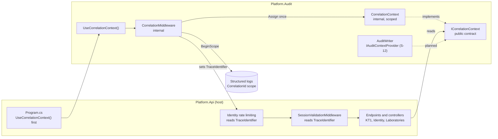
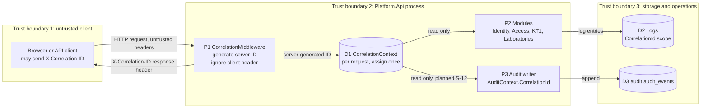

# Audit module: request correlation context (S-10)

**Owner:** Kristijan Oros (Team 12, member 10) · **Story:** S-10 · **Reviewer:** member 9
**Requirements:** AUD-01 (trusted correlation in audit records), AUD-04 (correlation of activity), SEC-01
**Agreement:** [INTEGRATION.md](INTEGRATION.md) S11-09 · open question 5 in [CONTRACTS.md](CONTRACTS.md)

## Problem

Finding F9 in [INTEGRATION.md](INTEGRATION.md): correlation IDs came from different places.
Most code read `HttpContext.TraceIdentifier`, whose default Kestrel format (`0HN...:00000001`)
contains `:` and is rejected by the audit contract (1 to 64 characters: ASCII letters, digits,
`-`, `_`, `.`). The Access demo endpoint created its own `Guid.NewGuid()`. One request could not
be followed from the HTTP call to the decision, the log line and the audit record.

## What S-10 adds

| Part | Location | Responsibility |
|-|-|-|
| `ICorrelationContext` | `Platform.Audit/Contracts` | Public, read-only. Any module reads the current request's correlation ID. |
| `CorrelationContext` | `Platform.Audit/Correlation` | Internal, scoped (one per request). The ID can be assigned once; a second assignment throws. |
| `CorrelationMiddleware` | `Platform.Audit/Correlation` | Internal. First in the pipeline, before routing and `UseAccessControl()`. Generates the ID, stores it, sets `TraceIdentifier`, a `CorrelationId` log scope and the `X-Correlation-ID` response header. The header is written in `Response.OnStarting`, so it survives a later `Response.Clear()` (for example in the Access problem-details writer). |
| `AddAudit()` | `Platform.Audit/Composition` | Registers the context as scoped, following [DI-GUIDELINES.md](DI-GUIDELINES.md). |
| `UseCorrelationContext()` | `Platform.Audit/Composition` | The only public way for the host to add the middleware. |
| `Program.cs` | `Platform.Api` | Calls `app.UseCorrelationContext()` directly after `builder.Build()`, before `UseRouting()` and `UseAccessControl()`, so requests denied by ACC-05 also carry the ID. |

Rules:

- The ID is always generated by the server: `Guid.NewGuid().ToString("N")`, 32 lowercase hex
  characters, valid for `AuditContext.CorrelationId`.
- An incoming `X-Correlation-ID` request header is ignored and overwritten in the response
  (S11-09) until its format and trust are agreed with the AUD-04 owner.
- The correlation ID is not a secret, not an authorization token and not a deduplication key.
- Because `TraceIdentifier` now carries the same value, existing code in Identity, rate limiting,
  KT1 coursework and Laboratories uses the shared ID without any change to those modules.

## Component architecture



## Data flow and trust boundaries



## Threats, controls and evidence

All tests are in `backend/Platform.Audit.Tests/CorrelationContextTests.cs`.

| Threat / misuse | Control | Test (evidence) |
|-|-|-|
| Client injects its own correlation ID to hide in or pollute another request's audit trail | Header ignored; server ID always generated and returned | `Request_WithClientCorrelationHeader_IgnoresClientValue` (3 cases, including a valid-looking ID and an existing audit ID) |
| Server code replaces the ID in the middle of a request | Assign once; second assignment throws | `Context_AssignedTwice_RejectsSecondValue`, `Context_AssignBlank_IsRejected` |
| One request reads another request's ID (captive or global state) | Scoped registration; resolving from the root provider fails under scope validation | `AddAudit_RegistersOneCorrelationContextPerScope`, `AddAudit_CorrelationContextFromRootProvider_IsRejected` |
| Correlation ID rejected by the audit contract | Generated format is 32 hex characters | `NewId_MatchesAuditContractFormat`, `Request_CorrelationIdIsAcceptedByAuditValidator` |
| HTTP response, log and module see different IDs | One value for context, `TraceIdentifier`, header and log scope | `Request_GetsServerIdInContextTraceIdentifierAndHeader`, `Request_LogsWrittenDuringRequestCarryCorrelationScope`, `Health_ResponseCarriesGeneratedCorrelationHeader`, `TwoRequests_GetDifferentCorrelationIds` |
| A request denied by the Access middleware cannot be traced | Correlation runs before `UseAccessControl()`; header written in `OnStarting` | `DeniedByAccessControl_ResponseStillCarriesCorrelationHeader` (fails if the middleware is moved after `UseAccessControl()`) |

Removing `app.UseCorrelationContext()` from `Program.cs` makes the HTTP tests fail, so the tests
prove the middleware is active in the real host. The test probe is marked `[DelegatedAuthorization]`
like the existing audit probe; it exists only in the test host and returns only the request's own ID.

## Demonstration

```bash
cd backend/Platform.Api
dotnet run --urls http://localhost:5080
```

In a second terminal:

```bash
curl -i http://localhost:5080/api/health
curl -i -H "X-Correlation-ID: attacker-chosen-id" http://localhost:5080/api/health
curl -i http://localhost:5080/api/access/demo-deny
```

1. Every response has an `X-Correlation-ID` with 32 hex characters, new for every request.
2. The client value `attacker-chosen-id` never appears in the response.
3. `demo-deny` still returns its own `correlationId` in the body, different from the header. This
   is the remaining F9 gap in the Access demo, owned by Team 3 (see the plan below).

Tests:

```bash
dotnet test backend/Platform.Audit.Tests/Platform.Audit.Tests.csproj --filter "FullyQualifiedName~CorrelationContextTests"
```

## Known limits

- Only HTTP requests get a correlation ID. A background job must create its own scope and
  assign an ID (planned together with the outbox in S-12/S-16).
- `AccessControlMiddleware` (ACC-05, Team 3), the Access demo endpoint and `AccountEndpoints`
  still create their own IDs with `Guid.NewGuid()`; the Access problem-details body therefore
  shows a `correlationId` that differs from the `X-Correlation-ID` header. Under the S11-09 temporary rule each module keeps its current ID until the
  owner agrees, so there is no claim of end-to-end correlation yet.
- Logs carry the ID only if the logging provider includes scopes (for example JSON console with
  `IncludeScopes`).

## Plan for the remaining work

| Step | Depends on | Target |
|-|-|-|
| Confirm with the AUD-04 owner that this middleware is the single correlation middleware | AUD-04 owner (S11-09) | before KT2 |
| Agree whether an incoming `X-Correlation-ID` is accepted, and in which format (open question 5) | AUD-04 owner, member 9 | before KT2 |
| Use `ICorrelationContext` in the audit context provider together with the trusted actor | S-12 (member 3), D10 | KT2 |
| Propose to Team 3 that `AccessControlMiddleware`, the Access demo and `AccountEndpoints` read `ICorrelationContext` (or `TraceIdentifier`) | Team 3, Teams 1 and 2 | KT2 |
| Correlation ID for background jobs and the outbox worker | S-12, S-16 | KT2 |

## Change history

| Date | Change |
|-|-|
| 2026-11-05 | Correlation context, middleware, tests and documentation (S-10) |
| 2026-11-05 | Merged main with ACC-05: correlation runs before `UseAccessControl()`, header in `OnStarting`, probe marked `[DelegatedAuthorization]`, denied-request test |
