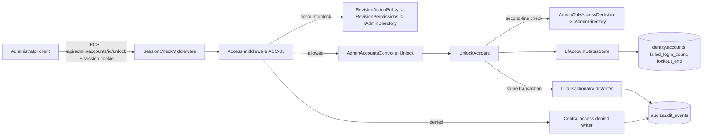
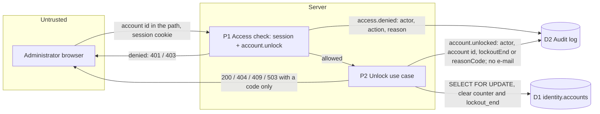

# Project component: IDN-05, Administrator unlock of a locked account

**Team:** 4

**Student:** milanmilosev1 / [student ID]

**Specification requirements:** IDN-05 (administrator unlock of the temporary lockout), with support for ACC-05 (central access check), AUD-01 and AUD-03 (audit of a privileged change)

> *Kao administrator, želim da ručno otključam zaključan nalog, kako bih pomogao korisniku koji je legitimno blokiran.*

## Responsibilities and boundaries

- **Processes and user scenarios:**
  - An administrator clears the lockout of one account that [the IDN-05 lockout](IDN-05-lockout.md) has locked. The account can log in again right away, instead of waiting up to `LockoutMinutes`.
  - The unlock sets `failed_login_count = 0` and `lockout_end = NULL` on `identity.accounts`. It does not change `status` (a lockout is separate from Blocked/Archived), and it does not create or revoke sessions.
  - The unlock and its audit record are committed in one transaction. Either both are stored or neither is, the same way IDN-03 status changes work.
  - Backend only. There is no frontend form in this component.
- **Contracts with other modules:**
  - **Access (ACC-05):** the route requires the action `account.unlock`. REV-05 (#85) already registers this action (System scope, privileged) with `RevisionActionPolicy` → `RevisionPermissions` → `IAdminDirectory`. This component reuses that single action id (`IdentityAccessActions.AccountUnlock = RevisionActions.UnlockAccount`) and does not register a second action or policy.
  - **Identity session:** `account.unlock` is in `IdentityAccessActions.IdentityOwned` and `SessionBound`. The subject comes from the validated session cookie (`IdentitySessionSubjectProvider`), and a missing or bad session gets the stable `401 session_invalid` from `SessionCheckMiddleware`.
  - **Audit:** a new catalog event type, `account.unlocked` (see [CONTRACTS.md](../audit/CONTRACTS.md)). It is written with `ITransactionalAuditWriter` in the same database transaction as the change.
  - **Persistence:** `IAccountStatusUnitOfWork.ClearLockoutAsync` in the IDN-03 store (`EfAccountStatusStore`). It works on the row that `FindForUpdateAsync` reads with `SELECT … FOR UPDATE`.
  - **Login (IDN-02 / IDN-05 lockout):** `ICredentialStore.ReserveAttemptAsync` now reports whether the attempt was charged, and `CredentialVerifier` refuses an attempt that was not charged (see the last rule below).
- **Implementation status:** done on branch `feature/IDN-05-admin-unlock`.

## Component architecture

## Data flow diagram

Trust boundary: the client is untrusted. The caller's identity comes only from the server-side session. Whether the caller is an administrator, whether the account exists and whether it is locked are all decided on the server.

## Behaviour (contract)

`POST /api/admin/accounts/{id:guid}/unlock`, no body, session cookie required.

| Case | HTTP | Body `code` | Audit (`account.unlocked`) |
|-|-|-|-|
| Admin unlocks a currently locked account | 200 `{ id, unlocked: true }` | – | Success, actor = admin, `lockoutEnd` = the exact cleared value (UTC, ISO 8601 ending with `Z`, with up to 7 fractional digits when the value has a fraction) |
| No or invalid session | 401 | `session_invalid` | none (stopped before Access) |
| Caller is not an admin | 403 | Access default | `access.denied` (central ACC-05 writer), no `account.unlocked` row |
| Unknown account id | 404 | `account_not_found` | Failure, `reasonCode=account_not_found` |
| Account is not locked (`lockout_end` null or ≤ now) | 409 | `account_not_locked` | Failure, `reasonCode=not_locked` |
| Admin targets their own account | 409 | `self_change_not_allowed` | Failure, `reasonCode=self_change` |
| DB error or audit not recorded | 503 | `unavailable` | rolled back, nothing stored |

Rules:

- "Not locked" returns 409 instead of an idempotent 200. This matches IDN-03 (`invalid_transition`), so the administrator sees that nothing changed.
- Self-unlock is refused, as in IDN-03. Otherwise an administrator whose account is under a guessing attack could reopen the guess budget from an existing session.
- `UnlockAccount` repeats the admin check as a second line (`IAccessDecision.CanUnlockAccount`). If that line ever refuses, the answer is `401 unauthenticated` or `403 forbidden` with a Denied `account.unlocked` record (`reasonCode` `unauthenticated` or `not_administrator`).
- The row lock from `FindForUpdateAsync` serializes administrator writes to the account (unlock, IDN-03 status change). It does **not** hold back logins during an unlock: the committed row is still locked, and the login `UPDATE`s (`ReserveAttemptAsync`, `LockIfLimitReachedAsync`, `TryClearFailuresAsync`) match only unlocked rows, so in PostgreSQL READ COMMITTED they skip the row without waiting and charge nothing. Such an in-flight login can then read the account after the unlock commits and see it unlocked. In-flight logins are therefore handled by the charge check: `ReserveAttemptAsync` returns whether it charged the attempt, and `CredentialVerifier` treats an attempt that was not charged as locked, whatever the password. Otherwise every login in flight during an unlock would be a free guess (lockout rule 2: only a charged attempt may use the password result).
- After an unlock the counter is 0, so a full run of `MaxFailedAccessAttempts` failures is needed before the account locks again.

## Security requirements

- **Server-side access checks:**
  - First line: the central Access middleware with `account.unlock` (System scope, privileged, admin-only through `IAdminDirectory`). A non-administrator never reaches the controller.
  - Second line: `UnlockAccount` checks the same `IAdminDirectory` again and refuses a self-unlock.
- **Input validation and sensitive data:**
  - The only input is the account id in the path, constrained by the `{id:guid}` route. There is no body.
  - Audit records carry the actor id, the account id, `lockoutEnd` (Success) or a short `reasonCode` (Denied/Failure). They never contain the e-mail, the password or a token. The catalog rejects any other detail key.
  - Responses carry only a code, never account details.
- **Negative scenarios:** see the tables below.

| Threat | Control | Test |
|-|-|-|
| A non-administrator unlocks an account (elevation of privilege) | Access denies `account.unlock` before the handler; the use case checks again | `AccountUnlockIntegrationTests.Student_CannotUnlock_NothingChanges_DenialIsAuditedByAccess`, `UnlockAccountTests.Student_IsForbidden_NothingChanges_DenialIsAudited` |
| An anonymous caller or a stale session (unknown token, revoked administrator session) | `401 session_invalid` (`no-store`, rejected cookie expired) from `SessionCheckMiddleware`; the use case refuses a caller without a full session | `WithoutSession_Returns401SessionInvalid_NothingChanges`, `InvalidSession_Returns401SessionInvalid_ClearsCookie_NothingChanges` (unknown and revoked), `Anonymous_IsUnauthenticated_NothingChanges_DenialIsAuditedWithoutActor`, `SessionWithoutFullAuthentication_IsUnauthenticated` |
| Cross-site request forgery: another site makes the administrator's browser send the body-less `POST` (a "simple" request, so no CORS preflight) | The session cookie is `SameSite=Strict` (`SessionCookie.Options`), so a cross-site request carries no session and gets `401 session_invalid`; the cookie is also `HttpOnly` and `Secure` | `LoginIntegrationTests.Login_WithValidCredentials_ShouldSetSessionCookieAndReturnUserId` (asserts `samesite=strict`), `WithoutSession_Returns401SessionInvalid_NothingChanges` |
| An administrator under attack reopens their own guess budget | Self-unlock refused and audited as Failure `self_change` | `Admin_CannotUnlockOwnAccount`, `Admin_CannotUnlockOwnAccount_Returns409_LockoutStays` |
| An unlock without an audit trail (repudiation) | Change and audit in one transaction; no audit record, no unlock | `AuditNotRecorded_RollsBackTheUnlock`, `AuditFailure_RollsBackTheUnlockAndTheAuditRow` (3 failure points) |
| A database failure leaves a half-done change | Rollback and `503 unavailable` | `DatabaseFailure_ReturnsUnavailable_AndStoresNothing`, `AuditFailure_RollsBackTheUnlockAndTheAuditRow` |
| A silent no-op hides that nothing changed (never locked, or the lockout already expired) | `409 account_not_locked` with a Failure record; the counter is not touched | `AccountThatIsNotLocked_ReturnsNotLocked_NothingChanges` (null, expired, ends exactly now), `AccountThatIsNotLocked_Returns409_AndFailureIsAudited`, `ExpiredLockout_Returns409_CounterUnchanged_AndFailureIsAudited` |
| A login in flight during the unlock gets a free guess (its attempt found the account locked and was not charged, then it reads the account already unlocked) | `ReserveAttemptAsync` reports whether it charged the attempt; `CredentialVerifier` refuses an uncharged attempt as locked, whatever the password | `AccountLockoutTests.Login_in_flight_during_an_admin_unlock_is_refused_whatever_the_password` (the real unlock commits between the charge and the read; failed before the fix), `PasswordAndCredentialTests.Verifier_AttemptThatWasNotCharged_IsRefused_EvenIfTheAccountNowLooksUnlocked` |
| Defence in depth: the counter is not 0 when the unlock runs | The unlock sets the counter to 0 together with `lockout_end`. A real lockout already restarts the counter at 0, so this guards against an arranged or future state, not a known path | `AfterUnlock_AFullRunOfFailuresIsNeededToLockAgain` (arranged with `failed_login_count = MaxFailedAccessAttempts - 1`) |
| Personal data in the audit log | Account id and fixed codes only; the catalog allows only `lockoutEnd` and `reasonCode` | `AuditRecords_NeverContainTheEmail`, `Admin_UnlocksLockedAccount_LoginWorksAgain_AndSuccessIsAudited` |
| A refusal turns into an error when audit is down | A refusal changes nothing, so it stays a refusal | `RefusalStaysRefused_WhenAuditIsUnavailable` |
| The route is not covered by exactly one registered policy | Endpoint metadata test | `RevisionEndpointMetadataTests.AuthRoutes_RequireExactlyOneRegisteredPolicy_WithoutMigrationMarkers` (`api/admin/accounts/{id:guid}/unlock`), `ApiEndpointCoverageTests.ACC05_Every_real_route_has_exactly_one_access_requirement` |

### Traceability (spec §8.1)

| Requirement ID | Precondition | Action | Expected | Evidence |
|-|-|-|-|-|
| IDN-05 | A student account is locked; the caller is an administrator | `POST /api/admin/accounts/{id}/unlock` | 200; `failed_login_count = 0`, `lockout_end` null; the correct password logs in | `Admin_UnlocksLockedAccount_LoginWorksAgain_AndSuccessIsAudited` (Testcontainers Postgres) |
| IDN-05 | The caller is a student | Unlock another account | 403; the lockout stays | `Student_CannotUnlock_NothingChanges_DenialIsAuditedByAccess` |
| IDN-05 | The account is not locked (never locked, or the lockout expired) | Unlock | 409 `account_not_locked`; nothing changes, the counter included | `AccountThatIsNotLocked_Returns409_AndFailureIsAudited`, `ExpiredLockout_Returns409_CounterUnchanged_AndFailureIsAudited` |
| IDN-05 | A login is in flight while the unlock commits | Login with any password | Refused as locked; not counted; the next login works | `Login_in_flight_during_an_admin_unlock_is_refused_whatever_the_password` |
| AUD-01 / AUD-03 | Admin unlock | Unlock | One `account.unlocked` Success record, actor = admin, no e-mail | `Admin_UnlocksLockedAccount_LoginWorksAgain_AndSuccessIsAudited`, `AuditRecords_NeverContainTheEmail` |
| AUD-01 | The audit write fails | Unlock | 503; the lockout and the audit log are unchanged | `AuditFailure_RollsBackTheUnlockAndTheAuditRow` |
| ACC-05 | – | Route metadata | Exactly one `RequireAccess(account.unlock)`, System scope, registered policy | `RevisionEndpointMetadataTests` |

### Residual risks

- **No frontend.** The administrator calls the endpoint directly (for example with the session cookie from the browser). A form is a separate change.
- **The deliberate lockout of a victim still works.** Anyone who knows a victim's e-mail can still lock the account. The unlock only shortens the outage, and a new run of failures locks the account again.
- **The administrator list comes from configuration** (`Stub:AdminIds` through `ConfigAdminDirectory`), the same source IDN-03 and REV-05 use.

## Evidence of work

- **Changed files:**
  - `Platform.Identity`: `UserAccount.ClearLockout()`; `ICredentialStore.ReserveAttemptAsync` returns whether it charged the attempt (`EfCredentialStore`), and `CredentialVerifier` refuses an uncharged attempt.
  - `Platform.Api`: `IAccountStatusUnitOfWork.ClearLockoutAsync` and `EfAccountStatusStore`, `IAccessDecision.CanUnlockAccount` and `AdminOnlyAccessDecision`, `UnlockAccountOutcome`, `UnlockAccount`, `AdminAccountsController.Unlock`, `IdentityAccessActions.AccountUnlock`, `Program.cs` (registration).
  - `Platform.Audit`: `AuditEventTypes.AccountUnlocked`, the `account.unlocked` schema in `AuditEventCatalog`.
  - Tests: `UnlockAccountTests`, `AccountUnlockIntegrationTests`, the in-flight unlock test in `AccountLockoutTests`, the uncharged-attempt test in `PasswordAndCredentialTests`, a test case in `RevisionEndpointMetadataTests`, an example in `AuditDraftExamples`.
  - No migration: the columns come from `AddAccountLockout`.
- **Run instructions:**
  - `dotnet test backend/Platform.Identity.Tests/Platform.Identity.Tests.csproj --filter "TestCategory=IDN-05|TestCategory=IDN-03"`. Docker is required for the Testcontainers tests.
  - Manual check in Development: lock a seeded student with N wrong `POST /api/auth/login`, log in as the dev admin (`11111111-1111-1111-1111-111111111111`), `POST /api/admin/accounts/{studentId}/unlock` with the admin cookie (200), log in as the student (200), repeat the unlock (409 `account_not_locked`), try it with the student's cookie (403).
- **Tests and results:** 2026-11-23: `Platform.Identity.Tests` with `TestCategory=IDN-05|TestCategory=IDN-03` 105 passed, 0 failed (22 in `UnlockAccountTests`, 13 in `AccountUnlockIntegrationTests`, 2 in-flight unlock cases in `AccountLockoutTests`; Testcontainers Postgres). The whole `Platform.Identity.Tests` project: 479 passed. `Platform.RateLimiting.Tests` 38 passed. `Platform.Audit.Tests` 293 passed, 36 skipped (Postgres tests that run only under `scripts/audit/test-postgres.ps1`). `Platform.Tests` (`RevisionAuthorization`) 101 passed. `Platform.Access.Tests` 232 passed. Both in-flight unlock cases failed before the `CredentialVerifier` fix: the correct password logged in, and the wrong password came back as a plain invalid attempt.
- **Next steps:**
  - An administrator form in the frontend.
  - REV-05 (`KT2-STATUS.md`, "Stvarna operacija otključavanja") can now point to this endpoint. That row belongs to the REV-05 owner.
