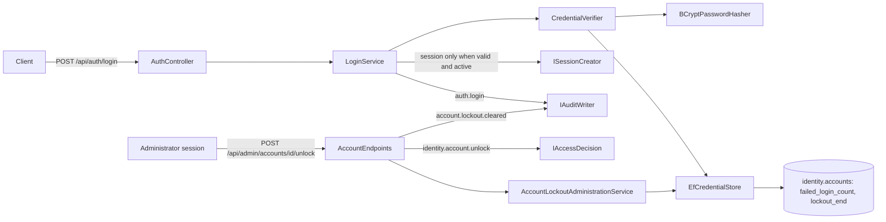
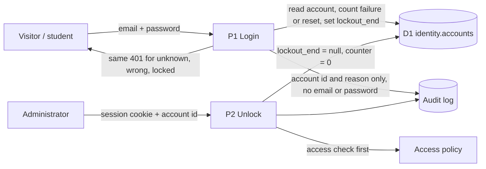

# Project component: IDN-05, Per-account lockout

**Team:** [number]

**Student:** milanmilosev1 / [student ID]

**Specification requirements:** IDN-05 (Ј, "Ограничење броја покушаја пријаве"), with support for SEC-04 and AUD-03

## Responsibilities and boundaries

- **Processes and user scenarios:**
  - Temporary lockout after consecutive failed logins.
  - The failure counter resets after a successful login.
  - The same generic response whether the account doesn't exist, the password is wrong or the account is locked.
  - An administrator can unlock an account.
- **Contracts with other modules:**
  - `ICredentialVerifier` (IDN-02) applies the lockout. `CredentialResult.IsLockedOut` exists for the audit only.
  - `ICredentialStore` gains `RecordFailureAsync` and `ClearFailuresAsync`.
  - `IAccountLockoutAdministration` handles admin unlock.
  - Access action `identity.account.unlock` uses policy `identity.account.unlock.admin-only` (ids in `Identity:AdminAccountIds`).
- **Why not ASP.NET Identity's `lockoutOnFailure`:** the ticket named it, but login does not use ASP.NET Identity. IDN-02 checks passwords against `identity.accounts` (`UserAccount`, BCrypt), and `sessions` has a foreign key to that table. `AspNetUsers` accounts cannot log in at all (see Known deviations in [the DFD](IDN-02_IDN-06_DFD.md)), so a lockout there would never run. The lockout therefore lives on `identity.accounts` and follows the same rules as Identity's: a failure limit, a lock window, a restart of the counter on lockout and a reset on success.
- **Relation to [IDN-05 rate limiting](IDN-05.md):** that component limits login requests per IP (SEC-04). This one adds the per-account lockout stored in the database, in place of the in-memory `ILoginAttemptLimiter` that document plans. A locked account gets **401**, not 429, so the response does not reveal that the account exists.
- **Implementation status:** done on branch `feature/IDN-05-identity-lockout`, connected to the real IDN-02 login and sessions.

## Component architecture

## Data flow diagram

Trust boundary: the client is untrusted. Every decision (counter, lockout window, admin right) is made on the server.

## Lockout rules

1. The account is read and the password hash is verified on **every** attempt, including unknown and locked accounts. `BCryptPasswordHasher` uses a dummy hash when there is no stored hash.
2. While `lockout_end` is in the future, the attempt is refused, even with the correct password. It is not counted and does not extend the lockout.
3. A correct password resets the counter and clears an expired lockout. A clean account is not written to.
4. Any other attempt runs one atomic `UPDATE`. The attempt that reaches the limit sets `lockout_end` and restarts the counter, so a full run of failures is needed after a lockout ends. An unknown email runs the same `UPDATE`, which matches no row, so it costs the same database round trip.

## Configuration

| Key | Default | Allowed | Meaning |
|-|-|-|-|
| `Identity:Lockout:MaxFailedAccessAttempts` | 5 | 1 to 20 | consecutive failures before the lockout |
| `Identity:Lockout:LockoutMinutes` | 15 | 1 to 1440 | length of the lockout |
| `Identity:AdminAccountIds` | none | account ids | who may unlock; set in `appsettings.Development.json` for the seeded admin |

The lockout values are validated by `IdentityLockoutOptionsValidator` with `ValidateOnStart`, so an invalid value stops the service from starting.

## Security requirements

- **Server-side access checks:**
  - The counter and the lockout window are stored in `identity.accounts` and enforced in `CredentialVerifier`.
  - Unlock takes the caller from the real session (`IIdentityContext`) and runs `IAccessDecision` **before** looking up the account, so a non-admin gets the same 403 for existing and unknown ids.
- **Input validation and sensitive data:**
  - Audit events carry the account id (when known) and a short reason (`invalid credentials`, `account locked`). They never contain the email, the password or a token.
  - For a locked account the id is the audit target, not the actor, because the caller has not proven who they are.
- **Negative scenarios:** see the table below.

| Threat | Control | Test |
|-|-|-|
| Online password guessing | Lockout after N failures for T minutes | `AccountLockoutTests.Reaching_the_limit_locks_the_account_for_the_configured_time` |
| Guessing the password while locked | Refused even with the correct password | `Correct_password_is_rejected_while_the_account_is_locked` |
| Parallel requests slipping past the limit | Atomic `UPDATE` | `Parallel_failures_are_all_counted` |
| Typos leading to a lockout | Counter resets on success | `Successful_login_resets_the_failure_counter`, `Successful_login_resets_the_counter_so_typos_do_not_add_up` |
| Account enumeration from the response | Identical 401 status, content type, cache header and body | `LockoutEndpointTests.Unknown_wrong_and_locked_logins_get_identical_responses` |
| Account enumeration from timing | Hash verified on every path, same update for unknown email | `Unknown_email_is_invalid_verifies_a_hash_and_creates_nothing`, `Locked_account_still_verifies_a_hash`, `Verifier_UnknownEmail_RunsTheSameFailureUpdate_SoTimingDoesNotReveal` |
| Unauthorized unlock, probing for accounts | Admin-only policy checked first | `Unlock_without_a_session_is_refused_and_changes_nothing`, `Non_admin_gets_the_same_403_for_existing_and_unknown_accounts` |
| Insecure configuration | Startup validation | `Out_of_range_values_fail_startup_validation`, `Host_refuses_to_start_with_an_invalid_lockout_setting` |
| Secrets in the audit log | Account id and reason only | `LoginTests.AuditEvents_NeverContainEmailPasswordOrToken` |

### Traceability (spec §8.1)

| Requirement ID | Precondition | Action | Expected | Evidence |
|-|-|-|-|-|
| IDN-05 | Active account, limit N | N wrong passwords | The account is locked; the next correct password gets 401 `invalid_credentials` | `AccountLockoutTests`, `LockoutEndpointTests` (Testcontainers Postgres) |
| IDN-05 | N-1 failures | Correct password | 200; `failed_login_count = 0` | `Successful_login_resets_the_failure_counter` |
| IDN-05 | Unknown email / wrong password / locked account | Login | The same 401 response, with no hint about the account | `LockoutEndpointTests` |
| IDN-05 | Locked account, admin session | `POST /api/admin/accounts/{id}/unlock` | 200 `unlocked: true`; login works again; `account.lockout.cleared` audited | `Admin_with_a_real_session_unlocks_an_account_and_login_works_again` |

### Residual risks

- **Deliberate lockout of a victim.** Anyone who knows a victim's email can lock the account on purpose (denial of service). The lockout is limited in time and an administrator can unlock it.
- **The per-IP limit is not attached to login yet.** `AuthController.Login` has no `[EnableRateLimiting(RateLimitPolicies.Login)]`, so the per-IP layer does not run on this endpoint. Until it does, spreading guesses across many accounts is limited only by each account's lockout.
- **A correct password on a blocked account resets its counter.** The login is still refused by `LoginService`, so this gives no access.
- **Accounts outside `identity.accounts`.** `AspNetUsers` accounts (IDN-01) cannot log in, and IDN-03 status changes still go to the in-memory repository. Both are known deviations, to be resolved when those stores move to D1 (ADM-02).

## Evidence of work

- **Changed files:**
  - `Platform.Identity`: `UserAccount`, `UserAccountConfiguration`, migration `AddAccountLockout`, `CredentialVerifier`, `EfCredentialStore`, `IdentityLockoutOptions`, `AccountLockoutAdministrationService`, `UnlockAccountPolicy`, `AdminAccounts`.
  - `Platform.Api`: `LoginService`, `AccountEndpoints` (unlock), `appsettings.Development.json`.
  - `Platform.Audit`: the `account.lockout.cleared` event type.
- **Run instructions:**
  - `dotnet test backend/SecurityLab.slnx`. Docker is required for the Testcontainers tests.
  - Development applies migration `AddAccountLockout` at startup. Other environments must apply it before deploying this version, because login reads the new columns.
- **Tests and results:** 2026-11-05: `Platform.Identity.Tests` 218 passed, 33 of them in category `IDN-05`, and a manual run in Development against a throwaway local Postgres confirmed lockout, identical 401 bodies, 403 for a teacher, admin unlock with a real session and login afterwards. With the lockout check disabled on purpose, 5 of the `IDN-05` tests failed, as they should. In the whole solution, 8 tests fail (`Platform.Audit.Tests` 7, `Laboratories.Tests` 1); the same 8 fail on `origin/main` at `e3c8f03` without this work.
- **Next steps:**
  - Add `[EnableRateLimiting(RateLimitPolicies.Login)]` to `AuthController.Login`.
  - Frontend: add an unlock action to the admin UI.
