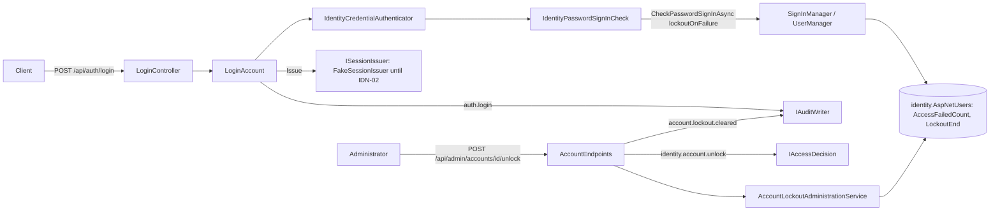
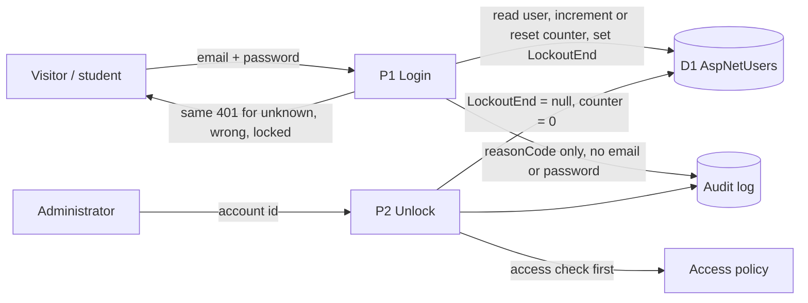

# Project component: IDN-05, Per-account lockout

**Team:** [number]

**Student:** milanmilosev1 / [student ID]

**Specification requirements:** IDN-05 (Ј, "Ограничење броја покушаја пријаве"), with support for SEC-04 and AUD-03

## Responsibilities and boundaries

- **Processes and user scenarios:**
  - Temporary lockout after consecutive failed logins.
  - The failure counter resets after a successful login.
  - The same generic response whether the account doesn't exist, the password is wrong or the account is locked.
  - An administrator can unlock an account.
- **Contracts with other modules:**
  - `Platform.Identity.Interfaces.IPasswordSignInCheck` checks the password with `SignInManager.CheckPasswordSignInAsync(..., lockoutOnFailure: true)` over `AppUser`.
  - `Platform.Identity.Interfaces.IAccountLockoutAdministration` handles admin unlock.
  - `Platform.Api.Services.Identity.ICredentialAuthenticator` (the IDN-02 boundary) is implemented by `IdentityCredentialAuthenticator`. It is now async and adds the `LockedOut` outcome and the account `Status`.
  - Access action `identity.account.unlock` uses policy `identity.account.unlock.admin-only` (ids in `Identity:AdminAccountIds`).
- **Relation to PR #28** (`feature/IDN-05-rate-limiting`): that branch limits login requests per IP (SEC-04). This component adds the per-account lockout stored in the database, and replaces the in-memory per-email limiter planned in PR #28's IDN-05 doc. Both layers are meant to run together. A locked account gets **401**, not 429, so the response does not reveal that the account exists.
- **Implementation status:** done on branch `feature/IDN-05-identity-lockout`. Until IDN-02 is merged, a temporary `FakeSessionIssuer` (Development/Testing only) returns an opaque token that is stored nowhere. In production, `UnavailableSessionIssuer` is still registered, so login fails closed with 503 after a valid password.

## Component architecture

## Data flow diagram

Trust boundary: the client is untrusted. Every decision (counter, lockout window, admin right) is made on the server.

## Configuration

| Key | Default | Allowed | Meaning |
|-|-|-|-|
| `Identity:Lockout:MaxFailedAccessAttempts` | 5 | 1 to 20 | consecutive failures before the lockout |
| `Identity:Lockout:LockoutMinutes` | 15 | 1 to 1440 | length of the lockout |

The values are validated by `IdentityLockoutOptionsValidator` with `ValidateOnStart`, so an invalid value stops the service from starting. `Lockout.AllowedForNewUsers` is set to `true` explicitly.

## Security requirements

- **Server-side access checks:**
  - The lockout counter and window live in `AspNetUsers` and are enforced by ASP.NET Core Identity.
  - A correct password during a lockout is still rejected.
  - Unlock runs `IAccessDecision` **before** looking up the account, so a non-admin gets the same 403 for existing and unknown ids.
- **Input validation and sensitive data:**
  - The email is trimmed and lowercased, and is at most 254 characters; the password is at most 128.
  - Unknown accounts, empty or oversized input, and already-locked accounts still verify a dummy PBKDF2 hash made by the same `IPasswordHasher<AppUser>`, so response time does not reveal the account.
  - Audit events carry only the account id (when known) and a `reasonCode` (`invalid_credentials`, `account_locked`, `account_blocked`, `account_archived`). They never contain the email, the password or a token.
- **Negative scenarios:** see the table below.

| Threat | Control | Test |
|-|-|-|
| Online password guessing | Lockout after N failures for T minutes | `AccountLockoutTests.Reaching_the_limit_locks_the_account_for_the_configured_time` |
| Guess the password while locked | Locked out even with the correct password | `Correct_password_is_rejected_while_the_account_is_locked` |
| Typos lead to a lockout | Counter resets on success | `Successful_login_resets_the_failure_counter` |
| Account enumeration from the response | Identical 401 status, content type and body | `LockoutEndpointTests.Unknown_wrong_password_and_locked_logins_get_identical_responses` |
| Account enumeration from timing | Dummy hash verification | `Unknown_email_is_invalid_and_still_verifies_a_hash`, `Already_locked_account_still_verifies_a_hash`, `Missing_input_is_invalid_and_still_verifies_a_hash` |
| Lockout state for unknown emails | No rows created | `Unknown_account_never_creates_lockout_state` |
| Unauthorized unlock / probing for accounts | Admin-only policy checked first | `Unlock_without_subject_is_unauthenticated`, `Non_admin_gets_the_same_forbidden_for_existing_and_unknown_accounts` |
| Insecure configuration | Startup validation | `IdentityLockoutOptionsTests.Out_of_range_values_are_rejected` |
| Secrets in the audit log | Reason codes only | `LoginAccountTests.Audit_never_contains_email_or_password` |

### Traceability (spec §8.1)

| Requirement ID | Precondition | Action | Expected | Evidence |
|-|-|-|-|-|
| IDN-05 | Active account, limit N | N wrong passwords | The account is locked; the next correct password gets 401 `invalid_credentials` | `AccountLockoutTests` (Testcontainers Postgres) |
| IDN-05 | N-1 failures | Correct password | 200; `AccessFailedCount = 0` | `Successful_login_resets_the_failure_counter` |
| IDN-05 | Unknown email / wrong password / locked account | Login | The same 401 response, with no hint about the account | `LockoutEndpointTests` |
| IDN-05 | Locked account, admin caller | `POST /api/admin/accounts/{id}/unlock` | 200 `unlocked: true`; login works again; `account.lockout.cleared` audited | `Unlock_clears_lockout_and_counter_so_correct_password_works`, `Admin_unlocks_a_locked_account` |

### Residual risks

- **Lost increments under parallel attempts.** Parallel wrong attempts on the same account can lose an `AccessFailedCount` increment on a `ConcurrencyStamp` conflict (Identity then returns `Failed` without counting). The per-IP limit from PR #28 bounds this.
- **Deliberate lockout of a victim.** An attacker who knows a victim's email can lock the account on purpose (denial of service). The lockout is limited in time and an administrator can unlock it.
- **IDN-03 status changes don't reach `AppUser`.** IDN-03 (`ChangeAccountStatus`) still writes status to the in-memory `IAccountRepository`. Login now reads status from `AppUser`, so a block made through `/api/admin/accounts/{id}/status` does not affect login yet. This gap belongs to IDN-03 and its persistence task.

## Evidence of work

- **Changed files:**
  - `Platform.Identity`: `IdentityLockoutOptions.cs`, `Services/IdentityPasswordSignInCheck.cs`, `Services/AccountLockoutAdministrationService.cs`, `Services/UnlockAccountPolicy.cs`, `Services/AdminAccounts.cs`, and the contracts and result types.
  - `Platform.Api`: `LoginAccount`, `LoginController`, `IdentityCredentialAuthenticator`, `FakeSessionIssuer`, `AccountEndpoints` (unlock), `Program.cs`.
  - `Platform.Audit`: the `account.lockout.cleared` event type.
  - `SecurityLab.slnx` now includes `Platform.Identity` and `Platform.Identity.Tests`, so CI runs them.
- **Run instructions:**
  - `dotnet test backend/SecurityLab.slnx`. Docker is required for the Testcontainers tests.
  - For a manual run, apply the migration to a **local** Postgres only, then start the API in Development with `ConnectionStrings__Identity`, `Identity__AdminAccountIds__0` and `Identity__DevSubjectId` set as environment variables or user secrets, never in tracked files.
- **Tests and results:** 2026-11-03, the whole solution passes, 225 tests (Identity 39, Platform 59, Audit 72, Authoring 55). A manual end-to-end run against a throwaway local Postgres confirmed the lockout after 3 attempts, identical 401 bodies, unlock and the counter reset.
- **Next steps:**
  - Remove `FakeSessionIssuer` once IDN-02 is merged.
  - IDN-02 should call `IPasswordSignInCheck` or `ICredentialAuthenticator` instead of a separate BCrypt store, so the lockout applies.
  - Frontend: show the generic message and add an unlock action to the admin UI.
