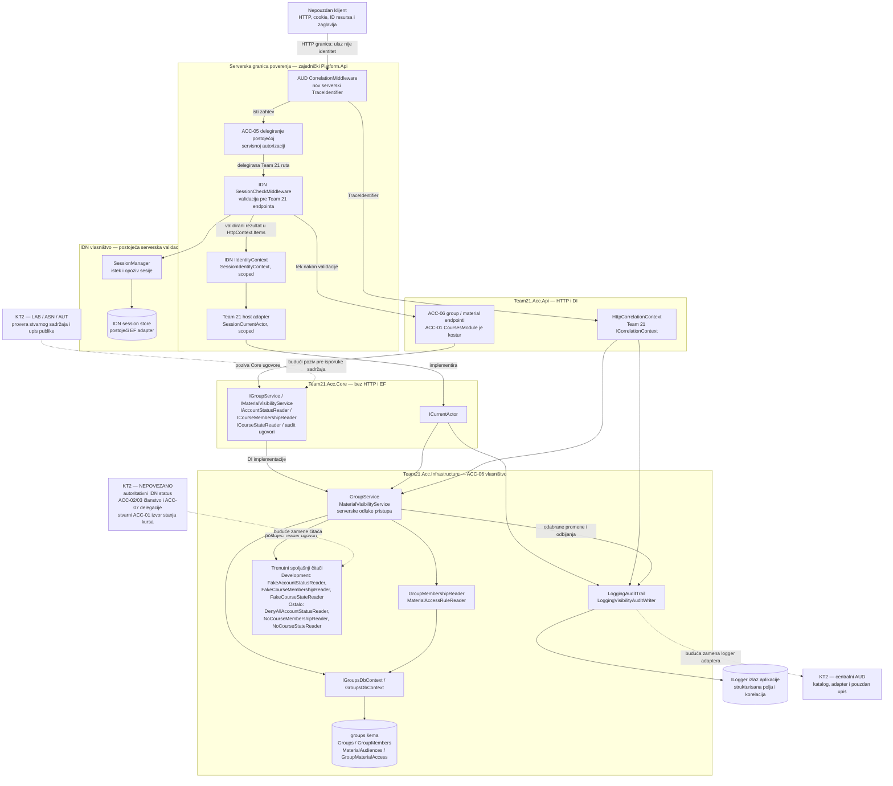

# Team 21, deo 9 — arhitektura za KT1

Prikaz radne grane `feature/acc-integration`, implementacioni HEAD `c94882e`. Veze predstavljaju ugovore i korišćene komponente, a redosled HTTP obrade prikazuje [DFD](DFD.md). Vlasništvo je označeno po modulu; host kompozicija i IDN ostaju zajedničke odgovornosti.

**Legenda:** puna strelica znači postojeću vezu, uključujući implementirane fake/deny-all zamene. Isprekidana strelica znači samo označenu buduću integraciju. Podgrafovi označavaju vlasništvo i serversku granicu poverenja; slojevi nisu zasebni mrežni servisi.

- Host eksplicitno zamenjuje `ICurrentActor` sa `SessionCurrentActor`; postojeći scoped `IIdentityContext` ostaje isti. Prihvata se samo `IsAuthenticated == true`, nivo `Active` i neprazan `UserId`. `X-Test-User`, `X-Stub-User` i ostala klijentska zaglavlja nisu izvor identiteta. Nema session bypass-a za `/api/courses` ili `/api/materials`, uključujući Development.
- `groups` šema i EF čitači postoje, ali njena PostgreSQL dostupnost nije dokazana InMemory testovima. Ne postoji nacrtana međumodulska FK veza. IDN skladište sesija nije izvor Team 21 statusa naloga; autoritativni status još nije potvrđen.
- `ICourseStateReader` ovde koristi fake ili `null` rezultat. ACC-01 je na ovoj grani kostur; noviji kod na udaljenom `main` nije uključen. Spajanje osnove i stvarni adapter ostaju poseban rad Tima 21.
- Materijalni endpointi vraćaju reference `Type`/`MaterialId`, a ne LAB/ASN sadržaj. Log izlaz nije dokaz centralnog AUD skladištenja niti garantovanog audit zapisa uz transakciju. `LoggingAuditTrail` dobija actor preko `ICurrentActor`; visibility writer dobija već formiran serverski događaj.

Izvori: [host kompozicija](../../../backend/Platform.Api/Program.cs), [session middleware](../../../backend/Platform.Api/Middleware/SessionCheckMiddleware.cs), [sesijski adapter](../../../backend/Platform.Api/Modules/Team21/Integration/SessionCurrentActor.cs), [Team 21 DI](../../../backend/Team21.Acc.Api/Team21AccModule.cs), [ACC-06 DI](../../../backend/Team21.Acc.Api/Groups/GroupsModule.cs), [Core ugovori](../../../backend/Team21.Acc.Core/Groups/Visibility/Interfaces/), [Infrastructure servisi](../../../backend/Team21.Acc.Infrastructure/Groups/Services/). [KT1 dokazi i ograničenja](KT1_READINESS.md).
