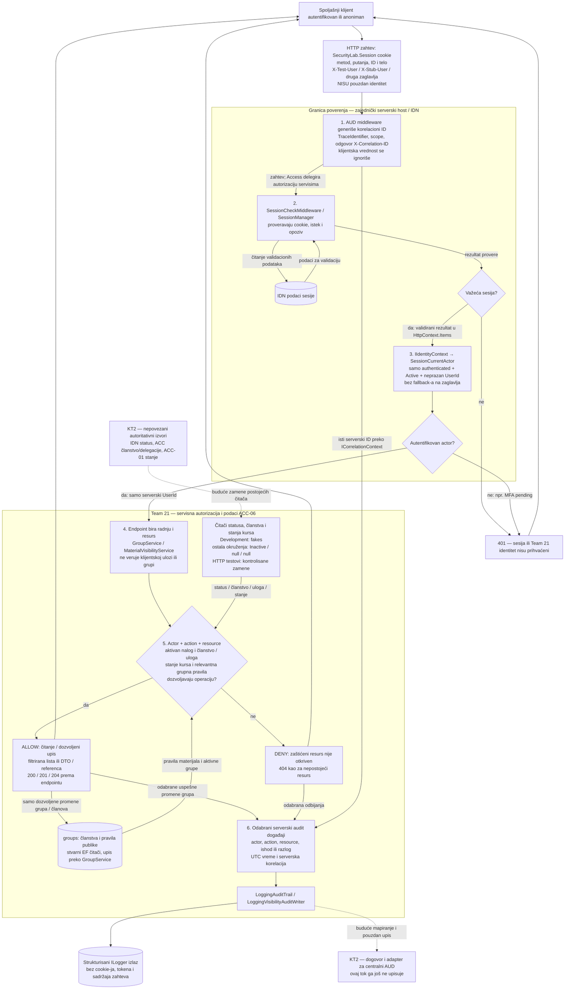

# Team 21, deo 9 — tok podataka za KT1

Tok stvarnih ACC-06 HTTP endpointa na implementacionom HEAD-u `c94882e`. Cookie je nepoverljiv ulaz dok ga IDN ne validira. Team 21 ne implementira login, skladište sesija ili opoziv.

**Legenda:** pune strelice su postojeći tokovi, uključujući testne zamene; isprekidane su isključivo buduće zavisnosti. Pravougaonici predstavljaju procese/podatke, rombovi odluke, a cilindri skladišta ili log izlaz. Serverska granica pretvara cookie u validirani identitet; granica Team 21 označava vlasništvo nad poslovnim odlukama, ne novu mrežnu zonu.

Ovo je sažet autorizacioni tok, ne univerzalni model svih odgovora. Nije svaka operacija zavisna od svih izvora: čitanje grupa proverava nastavnika i aktivan nalog/članstvo, dok promene dodatno traže aktivan kurs/grupu. Materijalni servis kurs i dozvoljene grupe uzima iz serverskog pravila materijala. Za `Read` i aktivan kurs pristup imaju odgovarajući članovi; arhiviranom kursu pristup zadržavaju nastavnik i asistent sa `CanReview`. Student dobija samo CourseWide ili reference dozvoljene njegovim aktivnim grupama. Uspešna lista može biti prazna; skriveni materijal se izostavlja, bez posebnog 404 za svaki element.

Nevažeći ulaz može dati 422, arhiviranje/sukob promene 409, a neispravna putanja može biti odbijena pre servisa. Nisu svi 404 niti uspešna čitanja auditovani. `LoggingAuditTrail` emituje `Outcome` za odabrane promene/odbijanja; visibility writer emituje samo odbijanja sa `Reason`, bez posebnog polja `Outcome`. Session 401 nije obećanje Team 21 audit događaja. Ovi logger-i ne čitaju zaglavlja/telo, ali nisu opšti sanitizer: pozivaoci moraju slati samo dogovorene metapodatke.

Korelacija je generisana na serveru i ostaje ista kroz zahtev i log. Testovi ne koriste stvarne kredencijale: zamenjuju skladišta EF InMemory providerom i spoljne čitače kontrolisanim podacima, uz stvarni IDN validator i Team 21 servise. Time se ne dokazuje status iz autoritativnog IDN repozitorijuma, PostgreSQL ponašanje, stvarni sadržaj LAB/ASN ili centralna AUD perzistencija.

Izvori: [IDN ugovor](../../contracts/IIdentityContext.md), [session middleware](../../../backend/Platform.Api/Middleware/SessionCheckMiddleware.cs), [adapter](../../../backend/Platform.Api/Modules/Team21/Integration/SessionCurrentActor.cs), [GroupService](../../../backend/Team21.Acc.Infrastructure/Groups/Services/GroupService.cs), [MaterialVisibilityService](../../../backend/Team21.Acc.Infrastructure/Groups/Services/MaterialVisibilityService.cs), [HTTP mapiranje](../../../backend/Team21.Acc.Api/Extensions/ResultHttpExtensions.cs), [HTTP testovi](../../../backend/Team21.Acc.Tests/Api/SessionCurrentActorHostIntegrationTests.cs). [Matrica odluka i pretnje](KT1_READINESS.md).
